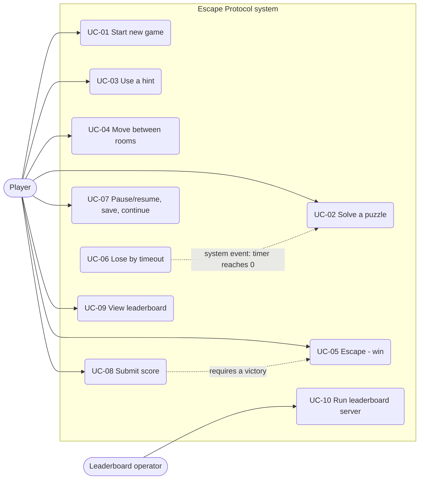
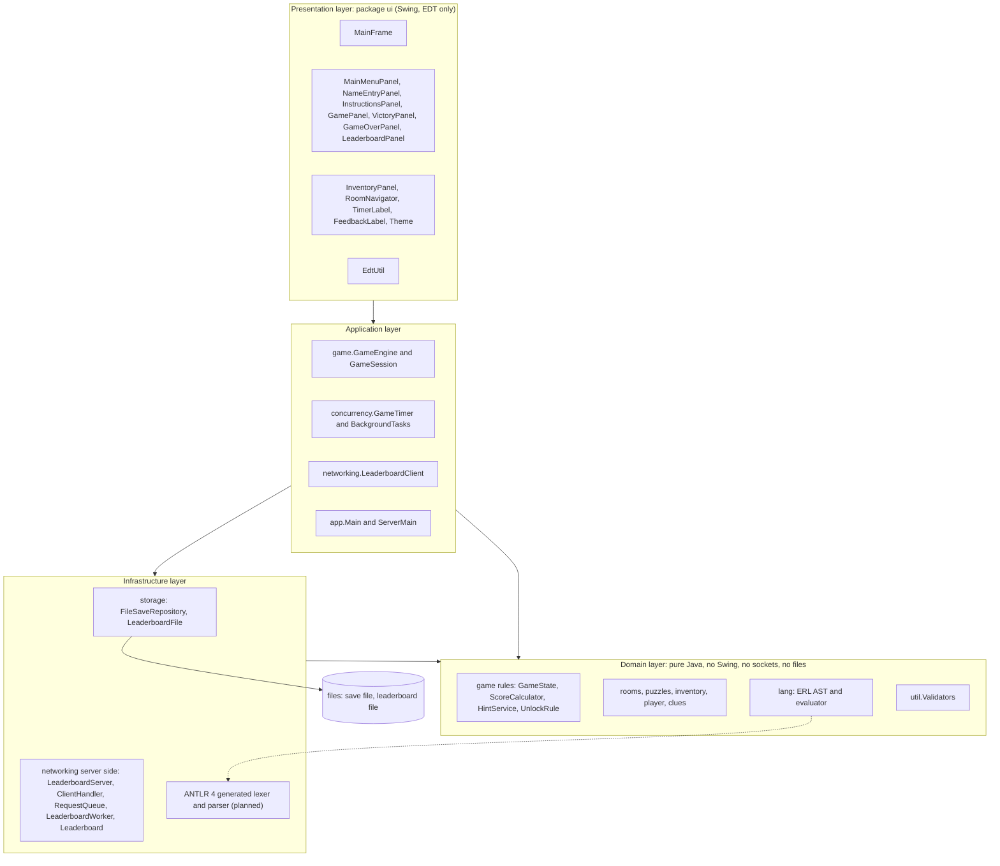
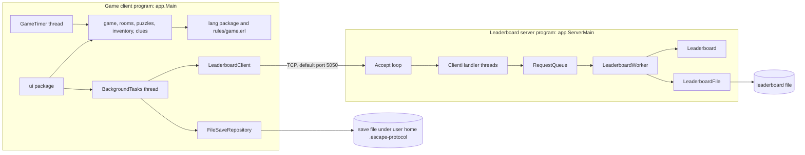
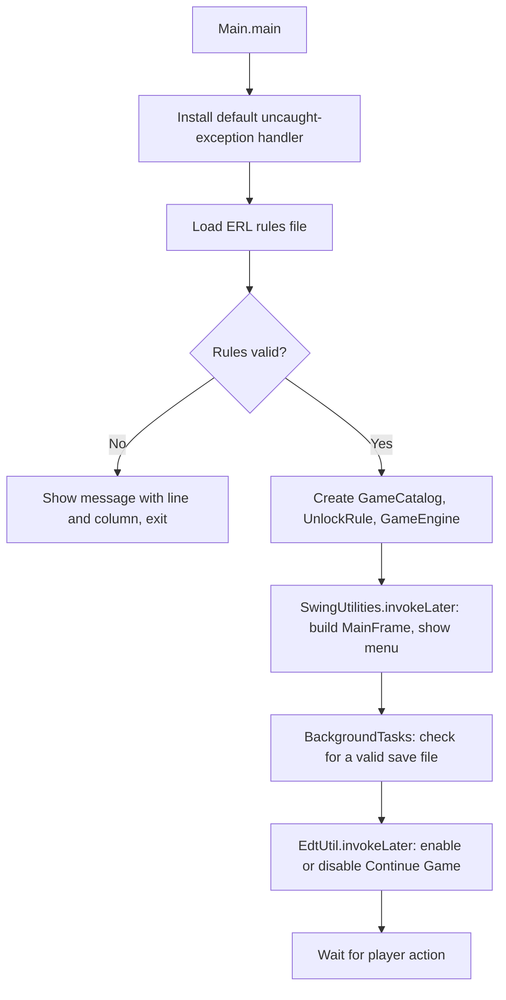
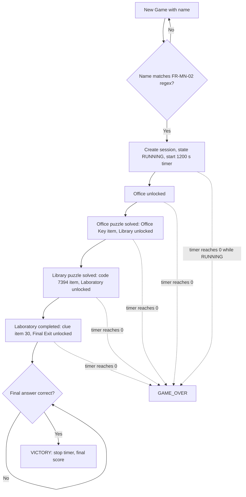
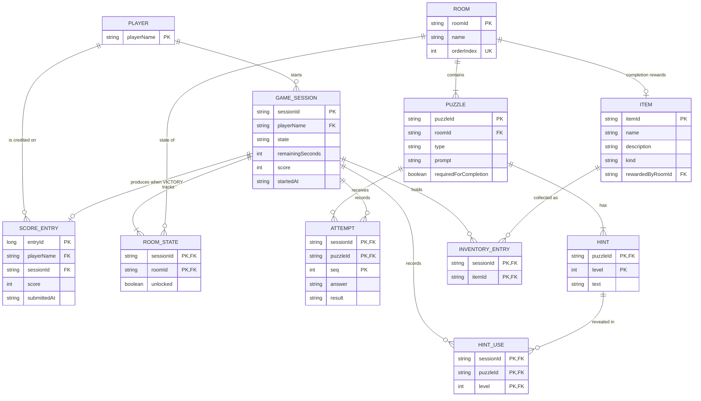
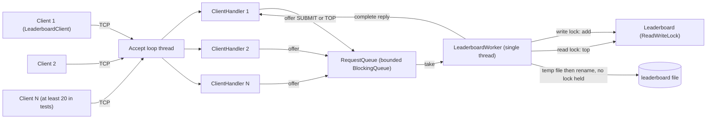

# Escape Protocol — The Last Exit: Architecture

| Item | Value |
|---|---|
| Course | Software Construction and Development (SE V), Sukkur IBA University |
| Document | Architecture (Module 01) — Revision 2 |
| Aligned with | `docs/SRS.md` v2.0 and `docs/Requirements-Traceability.md` v2.0 |
| Status | **DRAFT, awaiting student review.** Everything below is **PLANNED**; nothing is implemented or tested. |
| Team | Member 1 `[Name and Roll Number]`, Member 2 `[Name and Roll Number]`, Member 3 `[Name and Roll Number — if applicable]` |

**Source-of-truth rule.** Requirement IDs (`FR-*`, `CON-*`, `ERR-*`, `SEC-*`, `NFR-*`, `DEP-*`, `AR-*`, `C-*`, `U-*`) are copied from the SRS and the traceability document. This file defines no requirement IDs of its own.

**Tag legend**

| Tag | Meaning |
|---|---|
| **[SRS]** | Value or rule stated in the SRS |
| **[SRS-proposed]** | Value the SRS itself marks "(proposed)" |
| **[M01-proposed]** | Design choice added in this module (not in the SRS); open to review |
| **[PENDING]** | Needs instructor or group confirmation (see §17) |

---

## 1. Purpose and Architectural Goals

This document describes how Escape Protocol will be structured so it can be built, tested and demonstrated. It contains no Java code.

| # | Goal | Driven by |
|---|---|---|
| G1 | Playable core first, advanced modules after | SRS priorities P1/P2/P3 |
| G2 | Domain logic independent of Swing, sockets and files | C-03, NFR-MT-01 |
| G3 | Shared mutable state has one documented guard | CON-01, CON-02, CON-05 |
| G4 | Swing touched only on the EDT; no network or file I/O on the EDT | FR-UI-07, CON-04, NFR-PF-01 |
| G5 | Every one of the 26 SCD concepts has an honest home | C-01 … C-26 |
| G6 | Simple enough that every member can explain any class in the viva | AI-02, AI-05 |

---

## 2. Requirements Summary

### 2.1 Functional requirements (all exact SRS IDs)

| Group | IDs | What it covers | Priority | Main architectural home |
|---|---|---|---|---|
| FR-MN | FR-MN-01 … FR-MN-06 | Menu, name entry (regex of FR-MN-02), instructions, exit, Continue (P2), Leaderboard button (P2) | P1/P2 | `ui`, `util.Validators` |
| FR-GM | FR-GM-01 … FR-GM-08 | Session, room order, unlocking, state machine, victory, timeout, restart, pause/resume (P2) | P1/P2 | `game`, `rooms` |
| FR-PZ | FR-PZ-01 … FR-PZ-13 | `Puzzle` interface, Office, Library, Laboratory (sequence P1, symbol **P2**), Final Exit, feedback rules | P1 (FR-PZ-07 is **P2**) | `puzzles`, `game` |
| FR-IV | FR-IV-01 … FR-IV-06 | Inventory, items only from solved puzzles, 3 hints per puzzle, clue tree (P2) | P1/P2 | `inventory`, `game`, `clues` |
| FR-TS | FR-TS-01 … FR-TS-08 | 20:00 countdown, background ticking, injectable clock, penalties, victory formula, stop rules, race rule | P1 | `concurrency`, `game` |
| FR-UI | FR-UI-01 … FR-UI-09 | Dark theme, screens, gameplay layout, EDT rule, victory/game-over screens, minimum size | P1 | `ui` |
| FR-PS | FR-PS-01 … FR-PS-06 | Save folder, save points, validated load, restore, leaderboard file, tamper checks | P2 | `storage` |
| FR-LB | FR-LB-01 … FR-LB-13 | TCP leaderboard server and client, protocol, validation, queue/worker, shutdown, UI screen | P2 | `networking`, `ui` |
| FR-LL | FR-LL-01 … FR-LL-07 | ERL grammar (ANTLR 4), AST, evaluator, syntax errors, `UnlockRule` integration, central regexes | P2 (FR-LL-07 is P1) | `lang`, `util` |
| FR-AD | FR-AD-01, FR-AD-02 | Recursive `ClueNode` tree; stream map/filter/reduce | P2 | `clues`, `game` |

### 2.2 Cross-cutting requirements

| ID | Summary | Where addressed here |
|---|---|---|
| CON-01 … CON-07 | Guard documentation, single session lock, leaderboard lock + `BlockingQueue`, EDT rule, lock order/no I/O under lock, named stoppable threads, concurrency tests | §13 |
| ERR-01 … ERR-03 | Clear messages for invalid input, boundary exception handling and logging, resources closed | §14 |
| SEC-01 … SEC-04 | Validate external input, bounded line (256) and clients (100 proposed), no secrets in repo, untrusted files | §15 |
| NFR-PF-01 … 03, NFR-RL-01 … 02, NFR-US-01 … 02, NFR-MT-01 … 03, NFR-TS-01 … 02, NFR-PT-01, NFR-DP-01, NFR-VC-01, NFR-DC-01 | Performance, reliability, usability, maintainability/static checking, testability, portability, deployment, version control, documentation | §3, §10, §13, §16 |
| DEP-01 … DEP-04 | Runnable JAR, server launch, README commands, deployment claimed only after verification | §16 |

Constraints used throughout: A-01 (Windows 10, Java 21+, `--release 21`), A-02 (same machine or LAN, default host `localhost`), A-04 (no DBMS, pending **Q-02**), C-01 (Swing only), C-03 (domain independent of Swing).

### 2.3 Use cases

Use cases UC-01 … UC-10 are defined in SRS §9. Diagram **U-01**:



*UC-06 is triggered by the timer, not by a player action, so it has no actor arrow.*

---

## 3. Proposed Layered Architecture

**[M01-proposed]** Four layers. Dependencies point **downward only** (Presentation → Application → Domain; Infrastructure depends on Domain).

| Layer | Contents | Rule |
|---|---|---|
| Presentation | `ui` | Only layer that imports `javax.swing` (NFR-MT-01). Runs on the EDT. |
| Application | `game.GameEngine`, `concurrency`, `networking.LeaderboardClient`, `app` | Coordinates domain objects, threads and I/O; owns the session lock. |
| Domain | `game` rules, `rooms`, `puzzles`, `inventory`, `player`, `clues`, `lang`, `util` | Pure Java: no Swing, no sockets, no files (C-03). |
| Infrastructure | `storage`, server side of `networking`, ANTLR-generated code | Files and sockets; hidden behind interfaces where useful (`SaveRepository`). |

---

## 4. Architecture Diagrams

### 4.1 Layered architecture (U-07, view 1)



### 4.2 Component and deployment view (U-07, view 2)

Two programs, one Maven project (SRS §2, DEP-02).



### 4.3 Index of design diagrams (traceability §7)

| ID | Diagram | Location |
|---|---|---|
| U-01 | Use-case | Architecture §2.3 |
| U-02 | Class diagram (domain + puzzles + networking) | Design §3 (parts A and B) |
| U-03 | Activity diagram (gameplay flow) | Design §5 |
| U-04 | Sequence: submit answer | Design §6 |
| U-05 | Sequence: submit score to server | Design §7.3 |
| U-06 | State diagram: game lifecycle | Design §8 |
| U-07 | Component / architecture | Architecture §4.1 and §4.2 |
| U-08 | ER diagram | Architecture §11.2 |
| U-09 | Concurrency and threading | Architecture §13.1 |
| U-10 | ERL grammar and AST | Design §16 |

---

## 5. Package and Folder Structure

Base package `com.escapeprotocol`. Package names are exactly those of traceability §8 (S-01 … S-13).

```text
D:\EscapeProtocol
├── pom.xml
├── README.md
├── .gitignore
├── docs\                         Proposal, SRS, Requirements-Traceability, Development-Plan,
│                                 Development-Log, Architecture, Design, Testing, ...
├── rules\game.erl                (optional external override of the ERL rules, see Design §16.5)
├── src\main\java\com\escapeprotocol\
│   ├── app\          Main, ServerMain                                   (S-01)
│   ├── game\         GameEngine, GameSession, GameState, GameListener, UnlockRule,
│   │                 HardCodedUnlockRule, ErlUnlockRule, UnlockContext, ScoreCalculator,
│   │                 HintService, GameStats, GameCatalog, SubmissionResult, HintResult,
│   │                 SessionSnapshot                                    (S-02)
│   ├── player\       Player                                             (S-03)
│   ├── rooms\        RoomId, Room                                       (S-04)
│   ├── puzzles\      Puzzle, PuzzleResult, OfficePuzzle, LibraryPuzzle, SequencePuzzle,
│   │                 SymbolPuzzle, FinalExitPuzzle                      (S-05)
│   ├── inventory\    Inventory, Item, ItemKind                          (S-06)
│   ├── ui\           MainFrame, MainMenuPanel, NameEntryPanel, InstructionsPanel, GamePanel,
│   │                 InventoryPanel, RoomNavigator, TimerLabel, FeedbackLabel, VictoryPanel,
│   │                 GameOverPanel, LeaderboardPanel, Theme, EdtUtil    (S-07)
│   ├── storage\      SaveRepository, FileSaveRepository, LeaderboardFile (S-08)
│   ├── concurrency\  GameTimer, Clock, BackgroundTasks                  (S-09)
│   ├── networking\   LeaderboardServer, ClientHandler, LeaderboardWorker, RequestQueue, Request,
│   │                 Protocol, Leaderboard, ScoreEntry, LeaderboardClient (S-10)
│   ├── lang\         Expr (Has, Solved, And, Or, Not), AstBuilder, ExprEvaluator, RuleLoader,
│   │                 RuleSet, RuleSyntaxException + generated parser    (S-11)
│   ├── clues\        ClueNode                                           (S-12)
│   └── util\         Validators                                         (S-13)
├── src\main\antlr4\com\escapeprotocol\lang\Escape.g4
├── src\main\resources\rules\game.erl
└── src\test\java\com\escapeprotocol\     mirrors the main packages
```

Classes marked **[M01-proposed]** beyond the names listed in the traceability document: `Clock`, `BackgroundTasks`, `GameListener`, `GameCatalog`, `HardCodedUnlockRule`, `UnlockContext`, `SubmissionResult`, `HintResult`, `SessionSnapshot`, `LeaderboardWorker`, `Request`, `RuleSet`, `RuleSyntaxException`, `ItemKind`. The traceability document says class names "may be refined in Module 01"; the traceability file should be updated to match (see §17, OD-04).

---

## 6. Responsibility of Each Major Package

| Package | Responsibility | Must not | May depend on |
|---|---|---|---|
| `app` | Entry points; wiring; default uncaught-exception handler | Contain game rules | all |
| `game` | Session, state machine, scoring, hints, unlock decisions, statistics | Import Swing, sockets or files | `rooms`, `puzzles`, `inventory`, `player`, `concurrency`, `lang` (only via `UnlockRule`), `util` |
| `player` | Validated player name | Know rooms or UI | `util` |
| `rooms` | `RoomId` order and `Room` definitions (required puzzles, completion reward) | Validate answers | `inventory` |
| `puzzles` | `Puzzle` contract, answer validation, hints | Update UI or inventory | `rooms` (for `RoomId`), `util` |
| `inventory` | Item set without duplicates | Decide unlocking | none |
| `clues` | Recursive clue-dependency tree | Mutate game state | none |
| `lang` | ERL AST, evaluator, loader (ANTLR) | Know about Swing | `rooms` (for `RoomId`) |
| `util` | Central `Validators` (all regexes, FR-LL-07) | Hold state | none |
| `concurrency` | `GameTimer`, `Clock`, `BackgroundTasks` | Contain game rules; import Swing | none |
| `storage` | Save file and leaderboard file read/write | Be called on the EDT | `game` (snapshot), `networking.ScoreEntry`, `util` |
| `networking` | Protocol, server, client, queue, leaderboard ADT | Import `ui` | `storage`, `util` |
| `ui` | Display state, collect input, call `GameEngine`, EDT helper | Hold game rules; do I/O | `game`, `networking` (client), `concurrency` |

---

## 7. Main Application Startup Flow



Rules:
- **[SRS]** An invalid rules file stops the game from starting, with a clear message (FR-LL-05). There is **no silent fallback** to built-in rules once ERL is integrated (M10). Before M10, `HardCodedUnlockRule` is used (the `UnlockRule` interface exists from M04, FR-LL-06).
- All Swing objects are created inside `SwingUtilities.invokeLater` (FR-UI-07).
- The save-file check is file I/O, so it runs on `BackgroundTasks`, and the result is applied on the EDT (CON-04). Continue Game is disabled until a valid save is confirmed (FR-MN-05).
- **Server start-up** (`app.ServerMain [port]`, **[M01-proposed]** launch form): read the port (default 5050, FR-LB-01), load the leaderboard file (FR-PS-05; malformed lines skipped and logged, SEC-04), start the worker thread, then the accept loop. Console logging per FR-LB-13.
- DEP-02: the server is a second main class in the same JAR (or a second JAR), documented in the README.

---

## 8. Game Session and Room Progression Flow

### 8.1 Flow



Notes:
- **[SRS]** Rooms exist in the order Office, Library, Laboratory, Final Exit (FR-GM-02). Only Office is unlocked at the start (FR-GM-01).
- Unlocking is decided only by `UnlockRule` (FR-GM-03, FR-LL-06). The UI shows locked rooms as locked and refuses entry with a message (FR-UI-04); the engine independently refuses submissions to locked rooms (FR-PZ-11), so a UI bug cannot bypass progression.
- **Laboratory completion** is when all *required* Laboratory puzzles are solved. `lab_sequence` (FR-PZ-06) is always required. The symbol puzzle (FR-PZ-07) is **P2**: if implemented it is also required; if cut, the sequence puzzle alone completes the room. **The decision is recorded in M05**; this document does not make it mandatory and does not remove it. Completion adds the clue item containing `30` (FR-PZ-08).

### 8.2 Legal state transitions (FR-GM-04)

| From | To | Trigger | Legal? |
|---|---|---|---|
| NOT_STARTED | RUNNING | New Game starts the session | Yes |
| RUNNING | PAUSED | Pause (FR-GM-08, P2) | Yes |
| PAUSED | RUNNING | Resume (FR-GM-08, P2) | Yes |
| RUNNING | VICTORY | Correct Final Exit answer (FR-GM-05) | Yes |
| RUNNING | GAME_OVER | Timer reaches 0 (FR-GM-06) | Yes |
| any other pair (for example PAUSED → VICTORY, VICTORY → RUNNING, GAME_OVER → RUNNING) | — | — | **No** |

Illegal transitions are **rejected and leave the state unchanged** (FR-GM-04): the operation returns a refusal and nothing is modified. VICTORY and GAME_OVER are terminal; later submissions are ignored (FR-GM-06). Restart (FR-GM-07) is not a transition: it creates a **new** session that starts at NOT_STARTED → RUNNING. If a game is running, the UI asks for confirmation first.

---

## 9. Puzzle Validation and Hint Flow

Detailed sequence diagram: **U-04** in Design §6. Summary of the order of checks inside `GameSession.submit`, all under the session lock (CON-02):

1. State must be RUNNING, otherwise refuse (FR-PZ-11).
2. The puzzle's room must be unlocked, otherwise refuse (FR-PZ-11).
3. If the puzzle is already solved, return `ALREADY_SOLVED`: no item, no penalty, no new attempt (FR-PZ-12).
4. If the puzzle declares required items (Final Exit) and the inventory lacks some, refuse and name the missing **kinds** (KEY / CODE / CLUE) (FR-PZ-09). This is not a wrong answer, so there is no penalty **[M01-proposed]**.
5. `Puzzle.submit(answer)` returns `PuzzleResult` = CORRECT / INCORRECT / INVALID_FORMAT (FR-PZ-01).
   - INVALID_FORMAT → format feedback, **no penalty**, not counted as an attempt (FR-PZ-13).
   - INCORRECT → recorded as an attempt, score minus 25, floor 0 (FR-TS-04). A wrong Final Exit answer reports how many of the three parts are correct, not which (FR-PZ-10).
   - CORRECT → recorded, puzzle marked solved. When the room's required puzzles are all solved, its completion item is added (FR-IV-02) and `UnlockRule` is re-evaluated for locked rooms.

**Hints (FR-IV-04, FR-IV-05).** Each puzzle has 3 progressive hints. Requesting a *new* hint reveals the next level and costs 50 points (floor 0). Viewing an already revealed hint is free. With no hints left, or when the game is not RUNNING or the room is not unlocked, the action shows a message and costs nothing. Hints for an already solved puzzle also cost nothing **[M01-proposed]**.

Input formats use only the central `Validators` regexes (FR-LL-07, §15).

---

## 10. Timer and Scoring Architecture

### 10.1 Timer (FR-TS-01 … FR-TS-03, FR-TS-06, FR-GM-06, FR-GM-08)

- `concurrency.GameTimer` ticks once per second on a `ScheduledExecutorService` thread named `ep-timer` (daemon, stoppable, CON-06).
- **Injectable clock (FR-TS-03):** `Clock` is a small interface returning nanoseconds (**[M01-proposed]**). The timer stores a **deadline** and computes remaining seconds from the clock on each tick (no drift accumulation). Tests use a fake clock and call the tick logic directly, so no real waiting; manual runs stay within ±2 s of wall-clock time after 5 minutes.
- Display: the UI shows mm:ss from 20:00 (1200 s), updated each second while RUNNING (FR-TS-01).
- **Pause stops the timer** and returns the remaining time; **resume continues from that remaining time** by computing a new deadline (FR-GM-08).
- **The timer stops on** victory, game over, exit and pause (FR-TS-06).
- Tick delivery: the timer calls `GameListener.onTick(remaining)` **outside** any lock; the UI adapter forwards it with `EdtUtil.invokeLater` (FR-TS-02, FR-UI-07).

### 10.2 Exactly one terminal state (FR-TS-08)

`GameSession` guards state with one `ReentrantLock` (CON-02). Both a correct final answer and timer expiry must take that lock, and each re-checks `state == RUNNING` inside it. **The first to acquire the lock wins; the second finds a terminal state and does nothing**, so a session is never both won and lost.

Boundary rule **[M01-proposed]**: while holding the lock, a correct final answer stops the timer and reads the remaining time. If that remaining time is already 0, the answer is treated as too late and the outcome is GAME_OVER. This keeps the outcome deterministic. It is tested by `SessionRaceTest`.

### 10.3 Scoring (FR-GM-01, FR-TS-04, FR-TS-05, FR-IV-04)

`game.ScoreCalculator` is a pure class; all values are **[SRS-proposed]** constants:

| Rule | Value |
|---|---|
| Initial score | 1000 |
| Wrong *valid* answer (INCORRECT) | −25 |
| Newly revealed hint | −50 |
| Floor | score never below 0 |
| Invalid-format input | no penalty |
| Re-viewing a hint, resubmitting a solved puzzle | no penalty, no duplicate item |
| Victory score | current score + 2 × remaining seconds |
| Timer | 1200 seconds |

The maximum possible victory score is 1000 + 2 × 1200 = 3400, which fits the leaderboard range 0–5000 (FR-LB-04).

---

## 11. Persistence Architecture

> **[PENDING] Instructor confirmation Q-02.** No DBMS is planned or approved (A-04, SRS §12). The logical model below is the data design; **file-based persistence is a proposed way to store it.** No DBMS is claimed as implemented or approved.

### 11.1 Physical storage (proposed)

| Data | Where | Written by | Requirement |
|---|---|---|---|
| Save file (session, rooms, inventory, hints, attempts, remaining time, score) | `<user.home>\.escape-protocol\` **[SRS-proposed]** | `FileSaveRepository` on `BackgroundTasks` | FR-PS-01 … FR-PS-04, FR-PS-06 |
| Leaderboard file (CSV-style) | server working directory (path configurable) | `LeaderboardWorker` only; write to a temp file, then rename | FR-PS-05 |
| Static definitions: ROOM, PUZZLE, HINT, ITEM | code and resources (`GameCatalog`) | developers | SRS §12 |

Rules:
- Save on room completion and on "Save & Exit" (FR-PS-02, P2). Slow file I/O never runs on the EDT (CON-04).
- Save and leaderboard files are **untrusted on load** (SEC-04). A corrupt or invalid save gives an error message, never a crash, and does not alter state (FR-PS-03, NFR-RL-02).
- A restored session is re-checked against domain invariants and the unlock rules, so a tampered file cannot unlock rooms without the required items and solutions (FR-PS-06). Stored "unlocked rooms" are compared with the rules; a mismatch rejects the file.
- Exact text format of the save file is fixed in M08 (SRS §12).
- **If a DBMS is ever required:** add `SaveRepository` and `LeaderboardRepository` interfaces implemented with JDBC, and generate the schema from the tables in Design §10 (SRS §12).

### 11.2 ER diagram (U-08)

Preserves the SRS §12 model and fixes its consistency gaps (listed under the diagram). Entity tables, keys and constraints are in **Design §10**.



**Consistency fixes relative to SRS §12** (each needs an SRS revision note; see §17, OD-05):
1. `SCORE_ENTRY` gets a surrogate key `entryId` (the SRS key `(name, submittedAt)` can collide under concurrent submissions) and explicit foreign keys to `PLAYER` and to the completed `GAME_SESSION`.
2. `ITEM` is rewarded by a **room completion** (`rewardedByRoomId`) instead of a single puzzle, because FR-PZ-08 awards the Laboratory clue on *Laboratory completion* and FR-PZ-07 (symbol puzzle) may or may not exist.
3. `PUZZLE.requiredForCompletion` records whether a puzzle must be solved to complete its room (needed for the P2 symbol puzzle decision).
4. "Solved puzzle" is derived: a puzzle is solved in a session iff an `ATTEMPT` with result CORRECT exists (no new entity).

---

## 12. Socket Leaderboard Client/Server Architecture



| Aspect | Design | Requirement |
|---|---|---|
| Server | Standalone console program; TCP port default 5050, configurable **[SRS-proposed]** | FR-LB-01 |
| Concurrency | One accept thread; one `ClientHandler` thread per connection from a bounded pool; at least 20 clients in tests | FR-LB-02 |
| Protocol | UTF-8, one request per line: `SUBMIT <name> <score>`, `TOP <n>`, `PING`, `QUIT`; full specification in **Design §14** | FR-LB-03 |
| Validation | Name by the FR-MN-02 regex; score 0–5000; `TOP` 1–50; line ≤ 256 characters | FR-LB-04, FR-LB-05, SEC-02 |
| Thread safety | `Leaderboard` ADT guarded by a read/write lock; order = score descending, then earlier submission first | FR-LB-06, CON-03 |
| Queue | Handlers enqueue `SUBMIT` and `TOP` requests on a bounded `BlockingQueue` (`RequestQueue`); one `LeaderboardWorker` consumes and applies them. `PING` and `QUIT` touch no shared state and are answered by the handler | FR-LB-07 |
| Client | 3-second connect timeout; runs on `BackgroundTasks`, never on the EDT; unreachable server → message, game continues | FR-LB-08 |
| Disconnects | Clean or abrupt disconnect affects no other client; resources released | FR-LB-09 |
| Shutdown | Stop accepting, finish queued work, close sockets, end threads; clients treat end-of-stream cleanly | FR-LB-10 |
| UI | Leaderboard screen fetches top 10 (rank, name, score) or shows an error; a session's score submits at most once, failed submissions can be retried | FR-LB-11, FR-LB-12 |
| Logging | Connections, disconnections and rejected requests logged to the console | FR-LB-13 |

**Trust limitation (for `docs/Limitations.md`):** the server cannot verify that a submitted score was earned; there is no authentication or encryption (out of scope per SRS §2).

---

## 13. Concurrency, Message Queues, Synchronization and Thread Safety

### 13.1 Thread inventory and diagram (U-09)

| Thread (name) | Program | Purpose | Touches Swing? |
|---|---|---|---|
| Swing EDT | Client | All UI creation, painting, listeners | **Yes, and only this thread** |
| `ep-timer` | Client | One tick per second; expiry | No |
| `ep-io` (`BackgroundTasks`, single thread) | Client | Save/load, save-file check, leaderboard client calls | No |
| `ep-accept` | Server | `ServerSocket.accept()` loop | n/a |
| `ep-client-N` (bounded pool) | Server | One connection each | n/a |
| `ep-worker` | Server | Consume `RequestQueue`, apply requests, write file | n/a |

All threads are named, stoppable and stopped on exit; none are non-daemon leaks (CON-06).

```mermaid
flowchart TB
    subgraph GAMEP["Game client program"]
        EDTT["Swing EDT: all UI creation, painting and listeners"]
        TIMT["ep-timer thread: ticks and expiry"]
        IOT["ep-io thread: save, load, leaderboard client calls"]
        SESSL{{"GameSession lock (ReentrantLock)"}}
        TIMTL{{"GameTimer internal lock"}}
    end

    subgraph SERVERP["Leaderboard server program"]
        ACCT["ep-accept thread"]
        CHT["ep-client-N threads (bounded, at most 100)"]
        Q2["RequestQueue (bounded BlockingQueue)"]
        WT["ep-worker thread"]
        LBL{{"Leaderboard ReadWriteLock"}}
    end

    EDTT -->|"engine calls"| SESSL
    TIMT -->|"tick, expire"| SESSL
    SESSL -->|"lock order: session first, then timer"| TIMTL
    TIMT -->|"EdtUtil.invokeLater"| EDTT
    IOT -->|"EdtUtil.invokeLater with result"| EDTT
    EDTT -->|"submit task"| IOT
    ACCT --> CHT
    CHT -->|"offer"| Q2
    Q2 -->|"take"| WT
    WT --> LBL
```



### 13.2 How UI updates reach the EDT (FR-UI-07, FR-TS-02, CON-04)

1. Background threads (`ep-timer`, `ep-io`) never touch a Swing component. They call `ui.EdtUtil.invokeLater(Runnable)`, which wraps `SwingUtilities.invokeLater` (or runs directly if already on the EDT).
2. `GameListener.onTick` and `onStateChanged` are invoked **after the session lock is released**; the UI adapter immediately hands the update to `EdtUtil`.
3. Background results (save finished, leaderboard rank, leaderboard error) are carried to the EDT the same way, as values.
4. No network or file I/O is performed on the EDT. EDT-side engine calls are short, in-memory, and take the session lock briefly (NFR-PF-01: EDT never blocked > 100 ms).
5. Enforcement: code-review item R-EDT and `EdtUtil.assertOnEdt()` guards in UI mutator methods **[M01-proposed]** (also serves C-08 *Avoiding Debugging*). See sequence diagram in Design §7.1.

### 13.3 Queues and message-passing (FR-LB-07, C-22)

| Queue | Producers | Consumer | Capacity |
|---|---|---|---|
| `RequestQueue` (`BlockingQueue<Request>`) | `ClientHandler` threads (`offer` with a short timeout) | `LeaderboardWorker` | Bounded (value chosen in M09) |

A `Request` carries the parsed command and a reply future. If the queue is full, the handler answers `ERR SERVER_BUSY`. Shutdown inserts a sentinel request so the worker finishes everything queued before it, then exits (FR-LB-10).

### 13.4 Locks and synchronization (CON-01, CON-02, CON-03, CON-05, C-23)

| Shared mutable object | Guard | Why |
|---|---|---|
| `GameSession` (state, score, inventory, solved set, hints, attempts) | `ReentrantLock`; all state changes atomic w.r.t. ticks, UI actions and expiry | CON-02, FR-TS-08 |
| `GameTimer` internals (deadline, run state, generation) | monitor (`synchronized`) **[M01-proposed]** | Pause/resume/stop vs. tick |
| `Leaderboard` entries | `ReentrantReadWriteLock` (write for `add`, read for `top`/`size`) | CON-03, FR-LB-06 |
| Next `entryId` | assigned inside the `Leaderboard` write lock | Unique, increasing, defines tie order |
| Active client count (limit 100) | `AtomicInteger` | SEC-02 |
| `RequestQueue` | the `BlockingQueue` implementation | Producer–consumer hand-off |
| Leaderboard file | single writer thread (confinement) | No lock needed |

**Lock order (CON-05):** `GameSession` lock → `GameTimer` monitor. The timer never calls back into the session while holding its own monitor. `Leaderboard` lock is a leaf: nothing else is acquired while holding it.
**No blocking I/O, queue operation or callback while holding a lock (CON-05).** File writes happen after the lock is released.

**Note on the leaderboard lock.** With a single worker thread applying all requests, the `Leaderboard` lock does not see contention in normal server operation. It remains required because `Leaderboard` is specified as a thread-safe ADT in its own right (CON-01, CON-03) and is stress-tested directly from 20+ threads (`LeaderboardConcurrencyTest`). See OD-08.

### 13.5 Planned concurrency tests (CON-07, AC-07)

| Test (planned) | Covers |
|---|---|
| `LeaderboardConcurrencyTest` | ≥ 20 threads submitting: no lost entries, unique ids, correct order |
| `MultiClientTest` | ≥ 20 real socket clients |
| `SessionRaceTest` | Timer expiry vs correct final answer: exactly one terminal state, repeated runs |
| `ServerShutdownTest` | Repeated start/stop, no leaked threads |

Nothing here has been written or run.

---

## 14. Error Handling and Logging Strategy

| Requirement | Strategy |
|---|---|
| ERR-01 | Every external input (UI, socket, save file, ERL file) is validated at the boundary; bad input yields a message or an `ERR` reply, never corrupted state |
| ERR-02 | UI action handlers and thread entry points catch unexpected exceptions, log them to the console, and show a friendly dialog (no stack trace to the player); default uncaught-exception handler installed in `Main` and `ServerMain` |
| ERR-03 | Sockets, streams and executors closed with try-with-resources / `finally` |

| Situation | Handling |
|---|---|
| Invalid answer format | `PuzzleResult` INVALID_FORMAT, feedback, no penalty |
| Programmer error (null argument, broken invariant) | Fail fast with `IllegalArgumentException` / `IllegalStateException`; `checkRep()` in ADTs |
| Corrupt save | Error message, state untouched (FR-PS-03) |
| Invalid rules file | Message with line and column, game does not start (FR-LL-05) |
| Leaderboard unreachable (client) | Message on the EDT, game continues (FR-LB-08) |
| Bad client request (server) | `ERR` reply, server and other clients unaffected (FR-LB-05) |

**Logging [M01-proposed]:** `java.util.logging` to the console (no extra dependency). The server logs connections, disconnections and rejected requests (FR-LB-13). Puzzle answers are not logged; raw client input is logged only truncated.

---

## 15. Security and Input Validation Considerations

| ID | Control |
|---|---|
| SEC-01 | All external input validated (regex / range / length) before use. All regexes are centralized in `util.Validators` (FR-LL-07): player name `^[A-Za-z0-9 _-]{1,20}$` (FR-MN-02), year and 4-digit code, final answer `^\d{4}-\d{4}-\d{1,3}$` **[SRS-proposed]**, protocol lines |
| SEC-02 | The server never executes or interprets text beyond the fixed protocol; lines bounded at 256 characters; client count bounded (100 **[SRS-proposed]**, extra connections get `ERR SERVER_BUSY`) |
| SEC-03 | No credentials, secrets or `.env` files in the repository; `.gitignore` excludes build output, logs and data; `git status` reviewed before each push |
| SEC-04 | Save and leaderboard files treated as untrusted (FR-PS-03, FR-PS-06): size and line limits, field validation, domain-invariant checks |

Additional **[M01-proposed]** measures: no Java object serialization (`ObjectInputStream` is not used); save file path is fixed under the `.escape-protocol` folder and never built from user text; server bind address configurable, default loopback (LAN use needs an explicit setting, A-02).
Known limitations (to appear in `docs/Limitations.md`): no authentication, no encryption, scores are client-reported, puzzle answers exist in compiled client code.

---

## 16. Technology Decisions and Reasons

| Decision | Status | Reason |
|---|---|---|
| Java, `--release 21`, runs on Java 21+ | **[SRS]** A-01, NFR-PT-01 | Fixed constraint; `--release` prevents using newer-only APIs |
| Swing (no JavaFX) | **[SRS]** C-01 | Built into the JDK |
| Maven; `mvn clean test`; `mvn clean package` | **[SRS]** NFR-TS-01, NFR-DP-01 | Standard lifecycle |
| JUnit 5 | **[SRS]** C-01 | Required test framework |
| `-Xlint:all`, target zero warnings | **[SRS]** NFR-MT-03 | Static checking (C-01) |
| Git and GitHub | **[SRS]** NFR-VC-01 | Repo `MuhammadJoyo/Escape-Protocol` (traceability D-01) |
| ANTLR 4 for ERL, parser generated by the build | **[SRS]** FR-LL-02 | Required real parser generator; plugin and exact version verified in M10, **PLANNED** |
| Real TCP sockets, `java.net` | **[SRS]** FR-LB-01 | Required networking deliverable |
| `BlockingQueue`, `ReentrantLock`, `ReentrantReadWriteLock`, `ScheduledExecutorService` | **[SRS]** CON-02, CON-03, FR-TS-02, FR-LB-07 | Standard `java.util.concurrent` tools |
| File-based persistence (text/properties for saves, CSV-style for leaderboard) | **[SRS-proposed] / [PENDING Q-02]** | No DBMS approved |
| Records for value types, sealed interface for `Expr` | **[M01-proposed]** | Immutability, built-in equality (Java 17+ features, available with `--release 21`) |
| `java.util.logging` | **[M01-proposed]** | No dependency |
| Text protocol over TCP | **[SRS-proposed]** FR-LB-03 | Easy to test and explain |
| Runnable JAR; server as second main class (or second JAR) | **[SRS]** DEP-01, DEP-02 | Packaging plugin chosen in M13; deployment **not claimed** until a built JAR is run (DEP-04) |

---

## 17. Architecture Risks and Unresolved Decisions

### 17.1 Risks

| ID | Risk | Mitigation |
|---|---|---|
| R1 | Many required deliverables vs. unknown deadline (A-03) | P1 core first; modules per Development Plan |
| R2 | ANTLR 4 Maven integration problems | Grammar skeleton and build integration early in M10; if blocked, mark C-18 `BLOCKED` with reason and agree a smaller demonstration with the instructor — a hand-written parser would **not** satisfy FR-LL-02 |
| R3 | Deadlock or races (session, timer, leaderboard) | One documented lock order; no I/O under lock; `SessionRaceTest`, `LeaderboardConcurrencyTest`, repeated runs (AC-07) |
| R4 | Swing updated off the EDT | Single `EdtUtil`; review item R-EDT; MT-UI-16 |
| R5 | Socket demo fails live | Localhost default; scripted demo V-02; error message path tested |
| R6 | Uneven workload across members | Contribution matrix in Development Plan (names not yet provided) |
| R7 | Persistence approach rejected (Q-02) | `SaveRepository` interface isolates storage; JDBC path described in §11.1 |

### 17.2 Unresolved decisions (visible, not silently resolved)

| ID | Decision | Owner / status |
|---|---|---|
| OD-01 | **Q-02**: instructor confirmation of file-based persistence (no DBMS) | Instructor — **PENDING** |
| OD-02 | **FR-PZ-07** symbol puzzle (P2): implement or cut; decision recorded in **M05** | Group — open |
| OD-03 | Team names, roll numbers and per-member responsibilities | Group — not yet provided |
| OD-04 | Traceability inconsistencies to correct: `C-09` lists `leaderboard.ScoreEntry` but no `leaderboard` package exists in §8 (this design uses `networking.ScoreEntry`); `S-09` lists an "EDT helper" in `concurrency` but FR-TS-02 and §3 place `EdtUtil` in `ui` (required by NFR-MT-01); new class names in §5 | Group |
| OD-05 | SRS §12 refinements in §11.2 (surrogate `entryId`, session link, room-based item reward, `requiredForCompletion`) need an SRS revision note | Group |
| OD-06 | The FR-MN-02 regex accepts an all-space name. The client trims first so the UI never sends one, but the server validating only by the regex would accept `   `. Add a rule only through a formal SRS revision | Group |
| OD-07 | FR-LB-03 says the protocol is "frozen in M01": review the exact reply formats in Design §14 (`OK <rank>`, `TOP <count>` lines, error codes, oversize-line behaviour) | Group |
| OD-08 | Whether `TOP` should bypass the queue so the read lock sees real contention (current design queues `SUBMIT` and `TOP`) | Group |
| OD-09 | ERL rules loaded from an optional external `rules/game.erl` with a classpath default, to support the live-edit demo V-04 | Group |
| OD-10 | Continue Game behaviour: restored session resumes RUNNING; save removed when a session ends | Group |
| OD-11 | Values to choose later: server idle read timeout, client read timeout, queue capacity, queue offer timeout, handler reply wait | Group, M09 |
| OD-12 | Exact ANTLR 4 version and plugin, verified against the installed JDK | Group, M10 |
| OD-13 | Other instructor questions (Q-01, Q-03 … Q-07) are tracked in `Development-Log.md` §7 and were not reviewed for this revision | Group |

---

## Completion Checklist (Architecture.md)

- [x] 1 Purpose and goals
- [x] 2 Requirements summary with exact SRS IDs (FR-MN, FR-GM, FR-PZ, FR-IV, FR-TS, FR-UI, FR-PS, FR-LB, FR-LL, FR-AD, CON, ERR, SEC, NFR, DEP); use-case diagram U-01
- [x] 3 Layered architecture (kept four layers)
- [x] 4 Architecture and component diagrams (U-07) and diagram index (U-01 … U-10)
- [x] 5 Package and folder structure (exact traceability package names)
- [x] 6 Package responsibilities and allowed dependencies
- [x] 7 Startup flow (client and server)
- [x] 8 Session and progression flow; legal state transitions (FR-GM-04); Laboratory/symbol-puzzle (P2) note
- [x] 9 Puzzle validation and hint flow
- [x] 10 Timer and scoring (exact values; race rule FR-TS-08)
- [x] 11 Persistence architecture; ER diagram U-08; Q-02 pending
- [x] 12 Socket leaderboard architecture (FR-LB-01 … FR-LB-13)
- [x] 13 Concurrency, queues, locks, thread safety, EDT delivery; diagram U-09
- [x] 14 Error handling and logging
- [x] 15 Security and input validation
- [x] 16 Technology decisions
- [x] 17 Risks and unresolved decisions (OD-01 … OD-13)