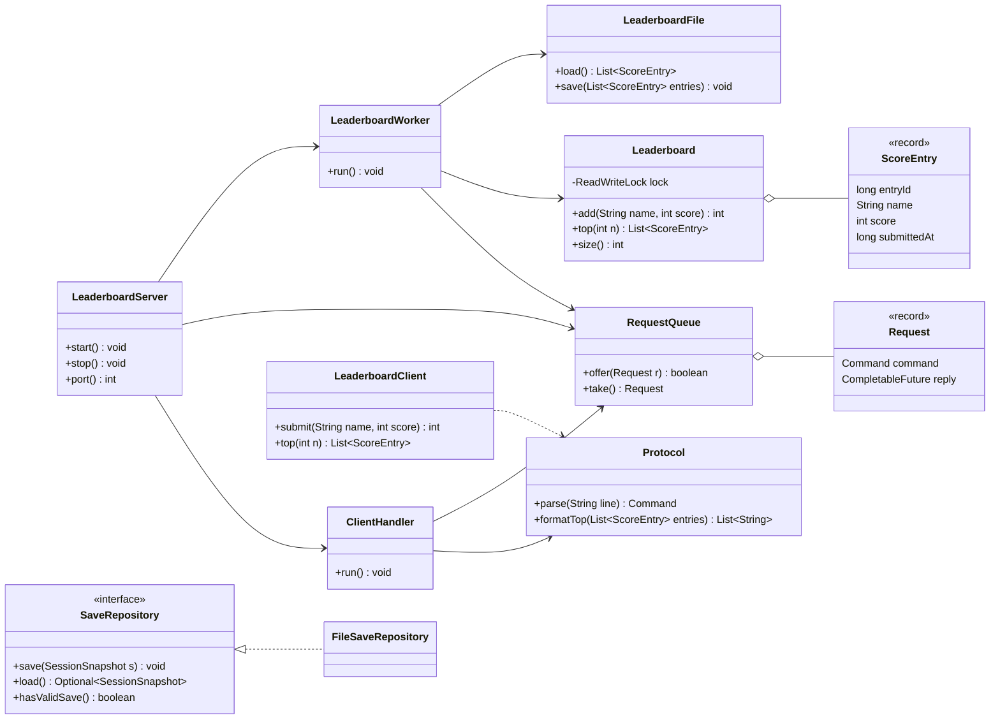
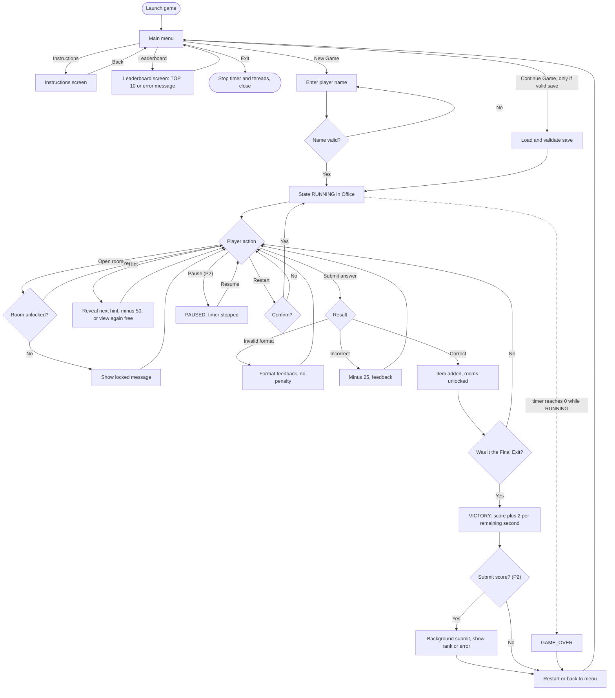
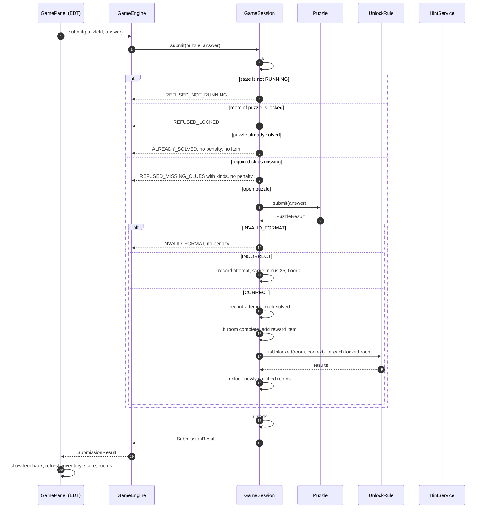
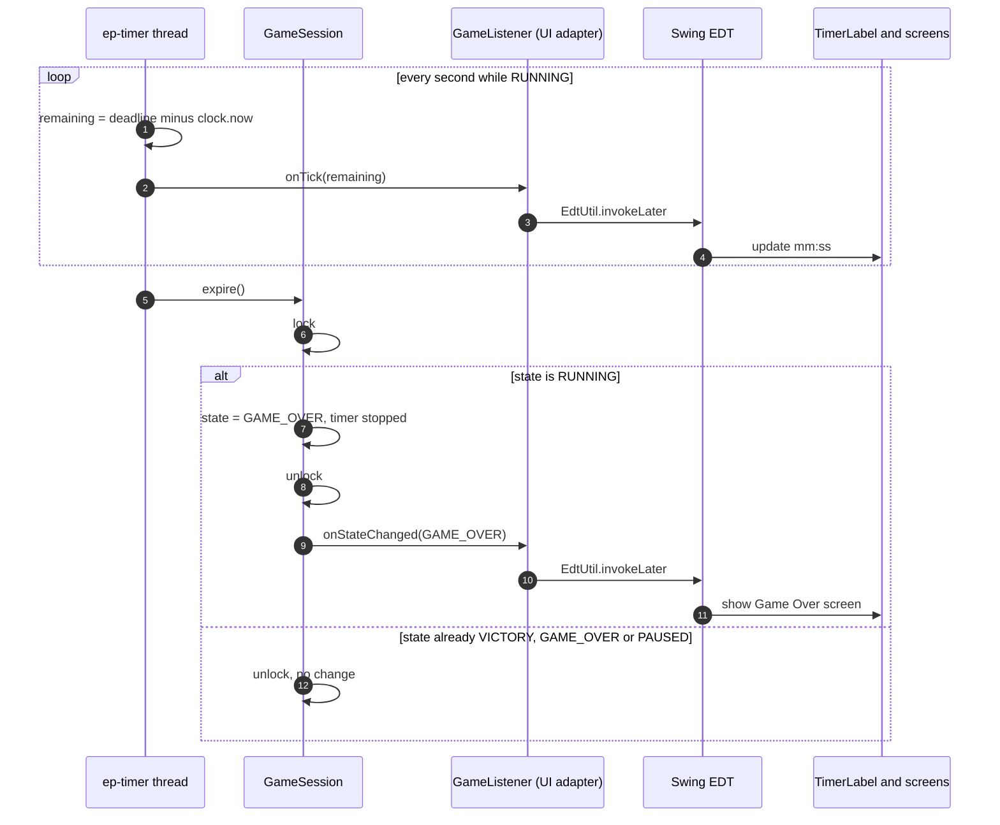
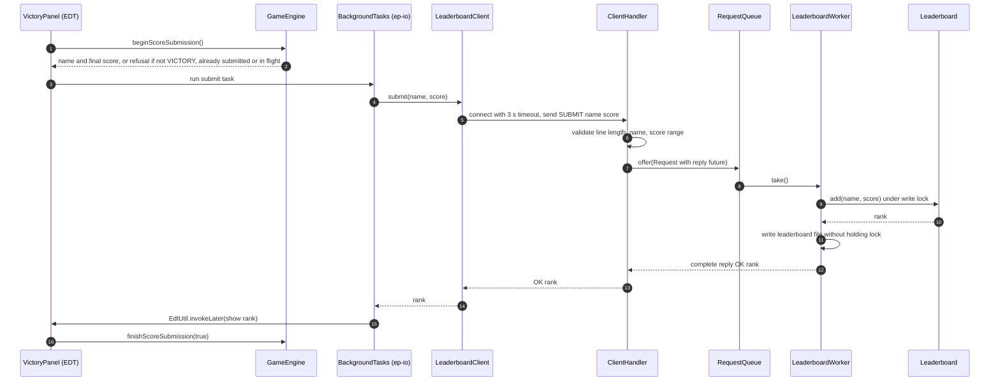
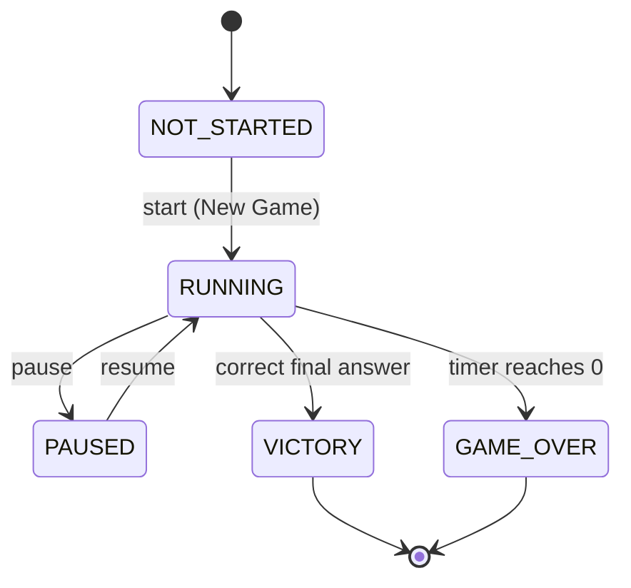
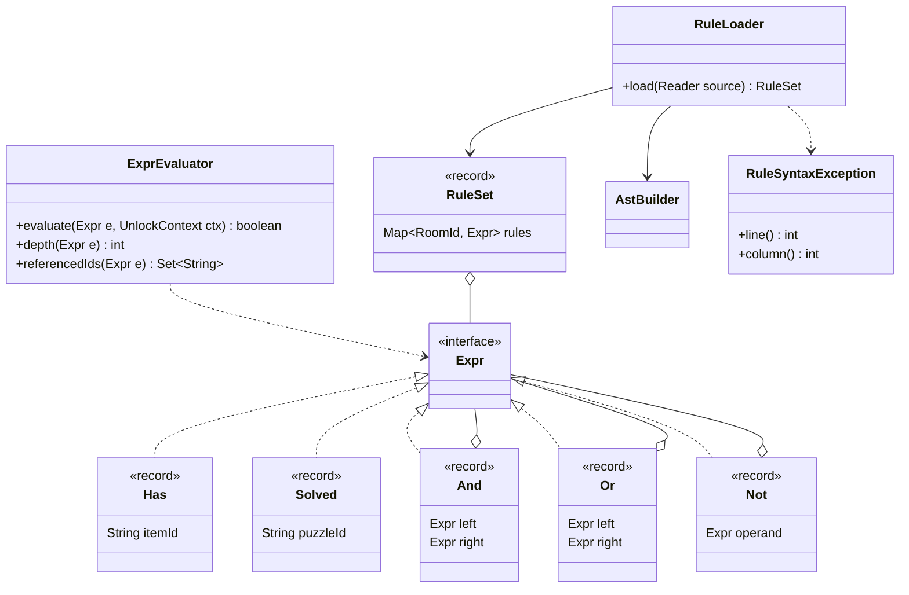
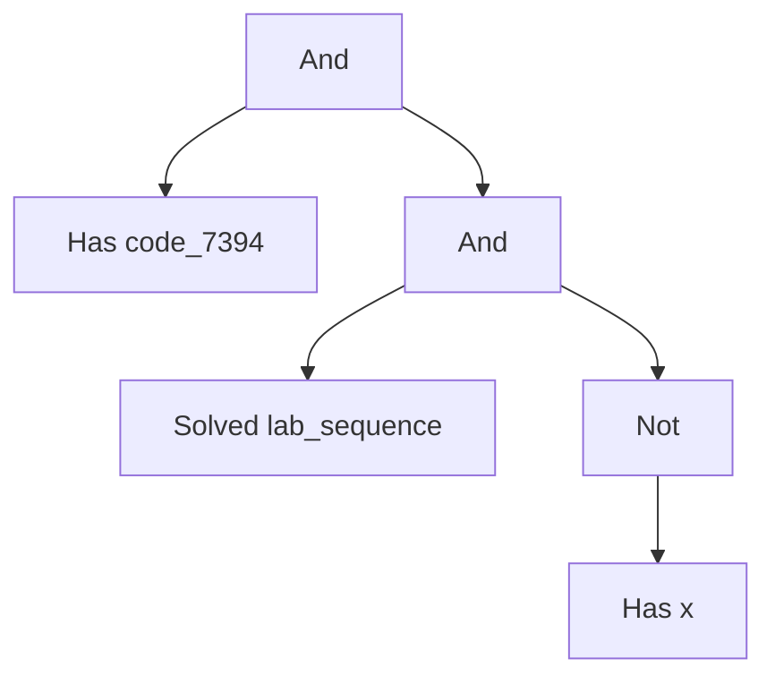
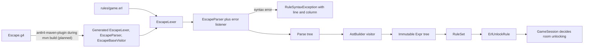

# Escape Protocol — The Last Exit: Design

| Item | Value |
|---|---|
| Course | Software Construction and Development (SE V), Sukkur IBA University |
| Document | Design (Module 01) — Revision 2 |
| Aligned with | `docs/SRS.md` v2.0 and `docs/Requirements-Traceability.md` v2.0 |
| Companion | `docs/Architecture.md` (Revision 2). Class and package names are identical in both files |
| Status | **DRAFT, awaiting student review.** Everything is **PLANNED**; nothing is implemented or tested. |
| Team | Member 1 `[Name and Roll Number]`, Member 2 `[Name and Roll Number]`, Member 3 `[Name and Roll Number — if applicable]` |

Tag legend: **[SRS]** stated in the SRS · **[SRS-proposed]** SRS marks it "(proposed)" · **[M01-proposed]** added in this module · **[PENDING]** needs confirmation (Architecture §17).

---

## 1. Design Overview and Principles

Escape Protocol is a Swing escape-room game with a separate TCP leaderboard server. Game rules live in plain Java classes; Swing, files and sockets are replaceable edges (C-03).

| Principle | Applied as | Concept |
|---|---|---|
| Separation of concerns | Four layers; no Swing outside `ui` | NFR-MT-01 |
| Program to interfaces | `Puzzle`, `UnlockRule`, `SaveRepository`, `GameListener`, `Clock`, `Expr` | C-14 |
| Immutable values, confined mutable state | Records for values; `GameSession`, `Inventory`, `Leaderboard` guarded | C-09, CON-01 |
| Fail fast | Validators at boundaries, `Objects.requireNonNull`, `checkRep()` | C-08 |
| Design by contract | Javadoc preconditions, postconditions, `@throws` | C-06, NFR-MT-02 |
| One reason to change per class | See §2 | AR-06 |
| Keep it demonstrable | Each concept has a named class and test | C-01 … C-26 |

---

## 2. Core Class Responsibilities

Names marked † are **[M01-proposed]**; all others appear in traceability §3/§8.

| Class / interface | Package | Responsibility | Main requirements |
|---|---|---|---|
| `Main`, `ServerMain` | `app` | Entry points, wiring, uncaught-exception handler | FR-MN-04, FR-LB-01, DEP-02 |
| `GameEngine` | `game` | Facade used by the UI: new game, restart, submit, hints, room check, pause/resume, snapshot, shutdown | FR-GM-01, FR-GM-07 |
| `GameSession` | `game` | One play-through; owns state, score, inventory, solved set, hints, attempts, timer, **the session lock** | FR-GM-04, FR-PZ-11 … 13, CON-02 |
| `GameState` | `game` | Enum NOT_STARTED, RUNNING, PAUSED, VICTORY, GAME_OVER with the legal-transition table | FR-GM-04 |
| `GameListener` † | `game` | `onTick(int)`, `onStateChanged(GameState)`; called outside locks | FR-TS-02 |
| `UnlockRule` | `game` | Decides if a room is unlocked from an `UnlockContext` | FR-GM-03, FR-LL-06 |
| `HardCodedUnlockRule` † | `game` | First implementation (M04) | FR-GM-03 |
| `ErlUnlockRule` | `game` | Second implementation, evaluates ERL (M10) | FR-LL-06 |
| `UnlockContext` † | `game` | Immutable view: owned item ids and solved puzzle ids | FR-LL-04 |
| `ScoreCalculator` | `game` | Pure scoring rules | FR-TS-04, FR-TS-05 |
| `HintService` | `game` | 3 progressive hints, cost and free re-view | FR-IV-04, FR-IV-05 |
| `GameStats` | `game` | Stream map/filter/reduce over real data | FR-AD-02 |
| `GameCatalog` † | `game` | Builds the static rooms, puzzles, hints and items | SRS §12 |
| `SubmissionResult`, `HintResult` † | `game` | Immutable results returned to the UI | FR-PZ-13, FR-IV-05 |
| `SessionSnapshot` † | `game` | Immutable copy of session state for UI and saving | FR-PS-04 |
| `Player` | `player` | Validated player name | FR-MN-02 |
| `RoomId`, `Room` | `rooms` | Room order; required puzzles and completion reward per room | FR-GM-02 |
| `Puzzle` | `puzzles` | Interface: id, room, prompt, submit, hints, required items | FR-PZ-01 |
| `PuzzleResult` | `puzzles` | Immutable CORRECT / INCORRECT / INVALID_FORMAT with feedback | FR-PZ-01, FR-PZ-13 |
| `OfficePuzzle`, `LibraryPuzzle`, `SequencePuzzle`, `FinalExitPuzzle` | `puzzles` | P1 puzzles | FR-PZ-02 … 06, 08 … 10 |
| `SymbolPuzzle` | `puzzles` | **P2**, decision in M05 | FR-PZ-07 |
| `Inventory`, `Item`, `ItemKind` † | `inventory` | Item set without duplicates; immutable item (equal by id); kind KEY / CODE / CLUE | FR-IV-01, FR-IV-02 |
| `ClueNode` | `clues` | Recursive clue tree | FR-IV-06, FR-AD-01 |
| `GameTimer`, `Clock` †, `BackgroundTasks` † | `concurrency` | Scheduled countdown with injectable clock; single named I/O thread | FR-TS-01 … 03, 06 |
| `Validators` | `util` | All regexes and range checks | FR-LL-07 |
| `Expr` (Has, Solved, And, Or, Not), `ExprEvaluator`, `AstBuilder`, `RuleLoader`, `RuleSet` †, `RuleSyntaxException` † | `lang` | ERL AST, recursive evaluation, ANTLR-based loading | FR-LL-01 … 05 |
| `SaveRepository`, `FileSaveRepository` | `storage` | Save/load with validation | FR-PS-01 … 04, 06 |
| `LeaderboardFile` | `storage` | Server leaderboard persistence, write-to-temp-then-rename | FR-PS-05 |
| `LeaderboardServer`, `ClientHandler`, `LeaderboardWorker` †, `RequestQueue`, `Request` † | `networking` | Server, per-client thread, consumer, queue | FR-LB-01 … 10 |
| `Protocol` | `networking` | Parse and format protocol lines | FR-LB-03 … 05 |
| `Leaderboard`, `ScoreEntry` | `networking` | Thread-safe ranking ADT; immutable entry | FR-LB-06 |
| `LeaderboardClient` | `networking` | Client with 3 s connect timeout | FR-LB-08 |
| `MainFrame`, `MainMenuPanel`, `NameEntryPanel`, `InstructionsPanel`, `GamePanel`, `InventoryPanel`, `RoomNavigator`, `TimerLabel`, `FeedbackLabel`, `VictoryPanel`, `GameOverPanel`, `LeaderboardPanel`, `Theme`, `EdtUtil` | `ui` | Screens and EDT helper | FR-UI-01 … 09 |

**P2 controls:** Pause, Save & Exit, Submit score and the Leaderboard button are P2 features (FR-GM-08, FR-PS-02, FR-UI-08, FR-MN-06). FR-UI-05 still applies: if they are shown, they must work.

---

## 3. Class Diagrams (U-02)

Split into two parts for readability; together they cover domain, puzzles and networking.

### 3.1 Part A — game domain, puzzles, inventory, timer

```mermaid
classDiagram
    direction TB
    class GameEngine {
        +newGame(String name) void
        +restart() void
        +submit(String puzzleId, String answer) SubmissionResult
        +requestHint(String puzzleId) HintResult
        +viewHint(String puzzleId, int level) HintResult
        +isUnlocked(RoomId room) boolean
        +pause() boolean
        +resume() boolean
        +snapshot() SessionSnapshot
        +shutdown() void
    }
    class GameSession {
        -ReentrantLock lock
        -GameState state
        -int score
        +submit(Puzzle puzzle, String answer) SubmissionResult
        +revealHint(Puzzle puzzle) HintResult
        +pause() boolean
        +resume() boolean
        +expire() boolean
        +snapshot() SessionSnapshot
    }
    class GameState {
        <<enumeration>>
        NOT_STARTED
        RUNNING
        PAUSED
        VICTORY
        GAME_OVER
        +canMoveTo(GameState next) boolean
    }
    class GameListener {
        <<interface>>
        +onTick(int remainingSeconds) void
        +onStateChanged(GameState state) void
    }
    class UnlockRule {
        <<interface>>
        +isUnlocked(RoomId room, UnlockContext ctx) boolean
    }
    class HardCodedUnlockRule
    class ErlUnlockRule
    class UnlockContext {
        <<record>>
        Set~String~ itemIds
        Set~String~ solvedPuzzleIds
    }
    class ScoreCalculator {
        +afterWrongAttempt(int score) int
        +afterHint(int score) int
        +victoryScore(int score, int remainingSeconds) int
    }
    class HintService
    class GameCatalog
    class GameStats
    class SubmissionResult {
        <<record>>
        Status status
        String message
    }
    class Player {
        +name() String
    }
    class RoomId {
        <<enumeration>>
        OFFICE
        LIBRARY
        LABORATORY
        FINAL_EXIT
    }
    class Room {
        <<record>>
        RoomId id
        int orderIndex
        List~String~ requiredPuzzleIds
    }
    class Puzzle {
        <<interface>>
        +id() String
        +roomId() RoomId
        +prompt() String
        +submit(String answer) PuzzleResult
        +hints() List~String~
        +requiredItemIds() Set~String~
    }
    class PuzzleResult {
        <<record>>
        Status status
        String feedback
    }
    class OfficePuzzle
    class LibraryPuzzle
    class SequencePuzzle
    class SymbolPuzzle
    class FinalExitPuzzle
    class Inventory {
        +add(Item item) boolean
        +contains(String itemId) boolean
        +items() List~Item~
    }
    class Item {
        <<record>>
        String id
        String name
        String description
        ItemKind kind
    }
    class ItemKind {
        <<enumeration>>
        KEY
        CODE
        CLUE
    }
    class ClueNode {
        +allRequired() Set~String~
        +depth() int
        +isObtainable(Set~String~ ownedIds) boolean
    }
    class GameTimer {
        +start(int seconds) void
        +pause() int
        +resume() void
        +stop() int
        +remainingSeconds() int
    }
    class Clock {
        <<interface>>
        +nanoTime() long
    }
    class Validators

    GameEngine --> GameSession : current
    GameEngine --> GameCatalog
    GameEngine --> UnlockRule
    GameEngine --> GameListener
    GameSession *-- Player
    GameSession *-- Inventory
    GameSession *-- GameTimer
    GameSession --> GameState
    GameSession --> ScoreCalculator
    GameSession --> HintService
    GameSession --> UnlockRule
    GameTimer --> Clock
    UnlockRule <|.. HardCodedUnlockRule
    UnlockRule <|.. ErlUnlockRule
    UnlockRule ..> UnlockContext
    GameCatalog o-- Room
    GameCatalog o-- Puzzle
    Puzzle <|.. OfficePuzzle
    Puzzle <|.. LibraryPuzzle
    Puzzle <|.. SequencePuzzle
    Puzzle <|.. SymbolPuzzle
    Puzzle <|.. FinalExitPuzzle
    Puzzle ..> PuzzleResult
    Puzzle ..> Validators
    Puzzle --> RoomId
    Room --> RoomId
    Room ..> Item : completion reward
    Inventory o-- Item
    Item --> ItemKind
    GameStats ..> Inventory
    ClueNode ..> Item
```



*`SubmissionResult.Status`: REFUSED_NOT_RUNNING, REFUSED_LOCKED, REFUSED_MISSING_CLUES, ALREADY_SOLVED, INVALID_FORMAT, INCORRECT, CORRECT, VICTORY. `PuzzleResult.Status`: CORRECT, INCORRECT, INVALID_FORMAT (FR-PZ-01). `HintResult.Status`: REVEALED_NEW, VIEWED_AGAIN, NO_MORE_HINTS, REFUSED. All **[M01-proposed]** names except the three `PuzzleResult` values.*

### 3.2 Part B — networking and storage



The ERL classes (`Expr`, `ExprEvaluator`, `RuleLoader`, …) are in the AST diagram in §16 (U-10).

---

## 4. Use-Case Diagram

The use-case diagram (**U-01**) is in **Architecture §2.3**, as listed in traceability §7. Use cases map to requirements as in SRS §9:

| UC | Use case | Related FR | Design sections |
|---|---|---|---|
| UC-01 | Start new game | FR-MN-02, FR-GM-01 | §5, §8 |
| UC-02 | Solve a puzzle | FR-PZ-* | §6 |
| UC-03 | Use a hint | FR-IV-04 | §2, §6 |
| UC-04 | Move between rooms | FR-GM-03 | §5 |
| UC-05 | Escape (win) | FR-PZ-09, FR-GM-05 | §6, §8 |
| UC-06 | Lose by timeout | FR-GM-06 | §7.1 |
| UC-07 | Pause/resume, save, continue | FR-GM-08, FR-PS-* | §8, §10.5 |
| UC-08 | Submit score | FR-LB-* | §7.3, §14 |
| UC-09 | View leaderboard | FR-LB-11 | §14 |
| UC-10 | Run leaderboard server | FR-LB-01, FR-LB-10 | §14, §15 |

---

## 5. Activity Diagram — Complete Game Flow (U-03)



---

## 6. Sequence Diagram — Puzzle Solving (U-04)



`HintService` (participant above) handles the separate hint flow: `requestHint` → under the session lock → if RUNNING, room unlocked and a next level exists, reveal it and subtract 50 (floor 0); `viewHint` returns an already revealed level at no cost.

---

## 7. Timer, Game-Over and Score-Submission Sequences

### 7.1 Countdown and game over (FR-TS-01, FR-TS-02, FR-GM-06)



### 7.2 Concurrent expiry and correct final answer (FR-TS-08)

| Step | EDT (final answer) | `ep-timer` (expiry) |
|---|---|---|
| 1 | `submit` waits for the session lock | `expire` waits for the session lock |
| 2 | Whoever gets the lock first checks `state == RUNNING` | same check |
| 3a | **EDT first:** timer stopped, remaining read (> 0), state VICTORY, score = score + 2 × remaining | then finds VICTORY, does nothing |
| 3b | **Timer first:** state GAME_OVER | then the answer finds GAME_OVER and is refused (FR-GM-06) |
| 3c | **Answer first but remaining already 0** (**[M01-proposed]**): treated as too late → GAME_OVER | finds a terminal state, does nothing |

Result: exactly one terminal state; never both. Verified later by `SessionRaceTest` (planned).

### 7.3 Submit score to the server (U-05, FR-LB-08, FR-LB-12)



On failure (unreachable server, `ERR`, timeout) the task calls `finishScoreSubmission(false)`, the UI shows a message, and the button stays enabled so the player can retry. After success the session is marked submitted and cannot submit again (FR-LB-12). The in-flight flag prevents a double-click from sending two submissions.

---

## 8. State Diagram — Game/Session States (U-06)



Exactly the states and transitions of FR-GM-04; the legal-transition table is in Architecture §8.2.

| Rule | Detail |
|---|---|
| Implementation | `GameState.canMoveTo(next)` is a fixed table; `GameSession` changes state only through one private method that checks it |
| Illegal request | Rejected: the public operation returns a refusal, **state is unchanged** (FR-GM-04) |
| Pause | Timer stopped, puzzle input and hint requests refused (FR-GM-08) |
| Resume | Timer continues from the same remaining time |
| Terminal | VICTORY and GAME_OVER have no outgoing transitions; Restart creates a new session (FR-GM-07) |
| Timer | Stopped on victory, game over, exit and pause (FR-TS-06) |

*Planned test: `GameStateTransitionTest` exercises every pair of states.*

---

## 9. Component Diagram

The component diagram (**U-07**) is in **Architecture §4.2**, with the layered view in §4.1. Components used in this file map to packages as in Architecture §5.

---

## 10. Database Design

> **[PENDING] Instructor confirmation Q-02.** No DBMS is planned, approved or implemented (A-04). This section is the **logical design**; file-based persistence is a **proposed** way to store it.

The ER diagram (**U-08**) is in **Architecture §11.2**. Entity names are identical.

### 10.1 Entities, keys and constraints

PK = primary key, FK = foreign key.

| Entity | Attributes | PK | FK | Constraints |
|---|---|---|---|---|
| PLAYER | playerName | playerName | — | DI-01 |
| GAME_SESSION | sessionId, playerName, state, remainingSeconds, score, startedAt | sessionId | playerName → PLAYER | DI-02, DI-03 |
| ROOM | roomId, name, orderIndex | roomId | — | orderIndex unique, 1–4 |
| ROOM_STATE | sessionId, roomId, unlocked | (sessionId, roomId) | sessionId → GAME_SESSION; roomId → ROOM | DI-05, DI-06 |
| PUZZLE | puzzleId, roomId, type, prompt, requiredForCompletion | puzzleId | roomId → ROOM | ≥ 1 puzzle per room |
| ATTEMPT | sessionId, puzzleId, seq, answer, result | (sessionId, puzzleId, seq) | sessionId → GAME_SESSION; puzzleId → PUZZLE | DI-08 |
| HINT | puzzleId, level, text | (puzzleId, level) | puzzleId → PUZZLE | level 1–3 |
| HINT_USE | sessionId, puzzleId, level | (sessionId, puzzleId, level) | sessionId → GAME_SESSION; (puzzleId, level) → HINT | DI-09 |
| ITEM | itemId, name, description, kind, rewardedByRoomId | itemId | rewardedByRoomId → ROOM | kind ∈ {KEY, CODE, CLUE}; at most one item per room |
| INVENTORY_ENTRY | sessionId, itemId | (sessionId, itemId) | sessionId → GAME_SESSION; itemId → ITEM | DI-10 |
| SCORE_ENTRY | entryId, playerName, sessionId, score, submittedAt | entryId | playerName → PLAYER; sessionId → GAME_SESSION (unique) | DI-11 … DI-13 |

Static definitions (ROOM, PUZZLE, HINT, ITEM) live in code/resources (`GameCatalog`); dynamic entities are written only if saving is implemented (P2); SCORE_ENTRY is written by the server.

### 10.2 Relationships and cardinalities

| Relationship | Cardinality | Meaning |
|---|---|---|
| PLAYER – GAME_SESSION | 1 : 0..* | A player may start many sessions |
| PLAYER – SCORE_ENTRY | 1 : 0..* | A player may have many leaderboard entries |
| GAME_SESSION – SCORE_ENTRY | 1 : 0..1 | A session produces at most one entry, and only after VICTORY (FR-LB-12) |
| GAME_SESSION – ROOM_STATE | 1 : 1..* (four rows) | Every session tracks all four rooms |
| ROOM – ROOM_STATE | 1 : 0..* | A room appears in many sessions |
| ROOM – PUZZLE | 1 : 1..* | A room contains at least one puzzle |
| ROOM – ITEM | 1 : 0..1 | Completing a room may reward one item (Final Exit rewards none) |
| PUZZLE – ATTEMPT | 1 : 0..* | A puzzle is attempted many times |
| GAME_SESSION – ATTEMPT | 1 : 0..* | A session records its attempts |
| PUZZLE – HINT | 1 : 3 | Three hints per puzzle (FR-IV-04) |
| HINT – HINT_USE, GAME_SESSION – HINT_USE | 1 : 0..* each | Which hint levels a session revealed |
| GAME_SESSION – INVENTORY_ENTRY – ITEM | many : many | Items held by a session |

**How a score entry relates to a completed session.** `SCORE_ENTRY.sessionId` is a unique foreign key to a `GAME_SESSION` whose state is VICTORY. The wire protocol (FR-LB-03) carries only `<name> <score>`, so the **server** file stores entries without `sessionId`; the link exists on the **client** (the victory screen's "already submitted" state per session, FR-LB-12). If a DBMS were adopted *and* the protocol formally revised, `sessionId` could become a physical column.

### 10.3 Integrity rules

| ID | Rule | Enforced by |
|---|---|---|
| DI-01 | `playerName` (after trimming) matches `^[A-Za-z0-9 _-]{1,20}$` (FR-MN-02) | `Validators`, `Player` |
| DI-02 | `state` ∈ {NOT_STARTED, RUNNING, PAUSED, VICTORY, GAME_OVER} | `GameState` |
| DI-03 | 0 ≤ `remainingSeconds` ≤ 1200; `score` ≥ 0 | `GameSession.checkRep()`, load validation |
| DI-04 | `SCORE_ENTRY.score` in 0–5000 (FR-LB-04); `entryId` unique and increasing; equals the session's victory score | `Protocol`/`Validators`, `Leaderboard` |
| DI-05 | OFFICE is always unlocked | `GameSession` |
| DI-06 | A room is unlocked only if its `UnlockRule` holds for the owned items and solved puzzles (also checked on load, FR-PS-06) | `UnlockRule` |
| DI-07 | A puzzle is solved iff a CORRECT `ATTEMPT` exists; at most one per (session, puzzle); no attempt after it | `GameSession` |
| DI-08 | `ATTEMPT.result` ∈ {CORRECT, INCORRECT}; INVALID_FORMAT input is never stored | `GameSession` |
| DI-09 | Hint levels are revealed in order 1, 2, 3; each (session, puzzle, level) at most once | `HintService` |
| DI-10 | No duplicate (session, item); an item exists only if its rewarding room is complete | `Inventory`, `GameSession` |
| DI-11 | One `SCORE_ENTRY` per session; session state must be VICTORY | `GameEngine.beginScoreSubmission` |
| DI-12 | Ranking order: score descending, then smaller `entryId` (earlier submission) first | `Leaderboard` |
| DI-13 | `entryId` is assigned inside the leaderboard write lock | `Leaderboard` |

### 10.4 Proposed file-based persistence

| File | Format | Notes |
|---|---|---|
| Save file under `<user.home>\.escape-protocol\` **[SRS-proposed]** | `key=value` text (properties style); exact keys fixed in **M08** | Holds player, remaining seconds, score, solved puzzles, items, unlocked rooms, hint levels, attempt counts. Unlocked rooms are re-derived from rules and compared on load (FR-PS-06). |
| Server leaderboard file | CSV-style: `entryId,name,score,submittedAt`, one entry per line | Names cannot contain a comma (DI-01), so no escaping is needed. Malformed lines are skipped and logged on load. Written by the single worker thread via temp file then rename (FR-PS-05). |

All file I/O runs off the EDT (CON-04). **Instructor confirmation Q-02 is still pending**; the `SaveRepository` interface keeps a JDBC alternative possible (SRS §12).

---

## 11. Data Structures and ADTs

| ADT | Representation **[M01-proposed]** | Key operations | Why |
|---|---|---|---|
| `Inventory` | `LinkedHashSet<Item>` (equal by id; keeps pickup order) | `add` (false if present), `contains`, `items` (unmodifiable copy) | No duplicates (FR-IV-01) |
| Room progression | `EnumMap<RoomId, Boolean>` unlocked flags + `Set<String>` solved puzzle ids inside `GameSession` | `isUnlocked`, re-evaluate after each correct answer | Fixed small key set |
| Puzzle results | Immutable records `PuzzleResult`, `SubmissionResult` | accessors | Safe to share between threads |
| Leaderboard | `ArrayList<ScoreEntry>` kept sorted (score desc, `entryId` asc), guarded by `ReentrantReadWriteLock` | `add` (returns rank), `top(n)`, `size` | Small N; deterministic order (FR-LB-06) |
| Request queue | bounded `BlockingQueue<Request>` | `offer`, `take` | Producer–consumer (FR-LB-07) |
| Clue tree | Immutable `ClueNode(itemId, List<ClueNode> prerequisites)` | `allRequired`, `depth`, `isObtainable(owned)` | Recursive structure (FR-AD-01) |
| ERL AST | Sealed `Expr` with records | see §16 | Recursive data type (FR-LL-03) |

**`ClueNode.isObtainable(owned)`** is true iff the node's item is owned, or it has prerequisites and **all** of them are obtainable. A leaf that is not owned is not obtainable. For the Final Exit tree (prerequisites: Office Key, code 7394, Laboratory clue) it is true only when all three are owned, matching FR-PZ-09. The game's Final Exit check does **not** depend on `ClueNode` (it is P2); a test may cross-check the two.

**Stream operations (FR-AD-02)** in `GameStats`:
- *filter*: solved puzzles from the puzzle list and solved set;
- *map*: inventory items → display names (`name`);
- *reduce*: total of hint and wrong-attempt penalties from the hint-use and attempt lists;
- leaderboard statistics (count, average, maximum) over the entries returned by `TOP` (`reduce`/summary).

---

## 12. Equality, Immutability, Representation Invariants and Specifications

### 12.1 Equality (C-15)

| Type | `equals` / `hashCode` | Planned test |
|---|---|---|
| `Item` | By `id` only (**[SRS]** FR-IV-01: items equal by id); `toString` readable | `ItemEqualityTest` |
| `ScoreEntry` | All fields (`entryId` makes each entry distinct) | `ItemEqualityTest`-style tests in `LeaderboardTest` |
| `Expr` records | Structural (all components) | `ExprStructureTest` |

Tests check reflexive, symmetric, transitive, consistent, the hash contract, and behaviour in `HashSet` and `HashMap`.

### 12.2 Immutability (C-09)

- **Immutable:** `Item`, `PuzzleResult`, `SubmissionResult`, `HintResult`, `SessionSnapshot`, `UnlockContext`, `ScoreEntry`, `Room`, `Expr` and subtypes, `RuleSet`, `ClueNode`. Fields `final`; collections copied with `List.copyOf` / `Set.copyOf` / `Map.copyOf`.
- **Mutable, confined:** `GameSession` (+ its `Inventory`), `GameTimer`, `Leaderboard`. Getters return copies or snapshots. Test: `ItemImmutabilityTest`.

### 12.3 Abstraction functions and representation invariants (C-13)

| ADT | Abstraction function (AF) | Representation invariant (RI) |
|---|---|---|
| `Inventory` | The set of keys, codes and clues the player holds | Set non-null; no `null` element; no two items share an id |
| `GameSession` | One play-through in progress or finished | `score ≥ 0`; state non-null; OFFICE unlocked; terminal state never changes; solved ⊆ known puzzle ids; every inventory item belongs to a completed room; every unlocked room satisfies its `UnlockRule`; 0 ≤ remaining ≤ 1200 |
| `Leaderboard` | Ranked list of submitted scores | List sorted by DI-12; `entryId` unique; no `null`; every score 0–5000; every name valid |
| `GameTimer` | Time left until the game ends | remaining ≥ 0; started at most once per session; at most one active schedule |

Each has a private `checkRep()` that throws `IllegalStateException` on violation, called at the end of constructors and mutators (C-08). Tests: `InventoryRepInvariantTest`, `LeaderboardTest`, `GameEngineTest`; `checkRep()` is also called from tests after operations.

### 12.4 Specification style and spec-to-test mapping (C-06, C-07)

Public methods are documented *requires / effects / returns / throws*. Example (specification, not code):

```text
Puzzle.submit(answer)
  requires: nothing (answer may be null, blank or any text)
  effects : none (pure with respect to the puzzle and the game)
  returns : a PuzzleResult; INVALID_FORMAT if answer fails the puzzle's format regex,
            CORRECT iff the (trimmed) answer equals the expected answer, otherwise INCORRECT
  throws  : never
```

| Specification | Planned test (traceability §6) |
|---|---|
| `Puzzle.submit` total and pure for every implementation | `PuzzleContractTest` |
| Each puzzle's correct / incorrect / invalid / boundary inputs (FR-PZ-02, 04, 06, 07, 09, 10) | `OfficePuzzleTest`, `LibraryPuzzleTest`, `SequencePuzzleTest`, `SymbolPuzzleTest`, `FinalExitPuzzleTest` |
| `GameSession.submit` refusals, no duplicate items or penalties | `ProgressionTest`, `ResubmitTest`, `PenaltyRulesTest` |
| `GameState.canMoveTo`; illegal transitions leave state unchanged | `GameStateTransitionTest` |
| `ScoreCalculator`: −25, −50, floor 0, 2 × remaining | `ScoreCalculatorTest` |
| `HintService`: 3 levels, cost once, free re-view, no hints left | `HintServiceTest` |
| `GameTimer`: tick, expiry, pause/resume, stop | `GameTimerTest`, `PauseResumeTest` |
| Timer vs final answer | `SessionRaceTest` |
| `Inventory`: no duplicates, invariants | `InventoryTest`, `InventoryRepInvariantTest` |
| `Protocol.parse` and replies | `ProtocolTest`, `MalformedRequestTest` |
| `Leaderboard.add` / `top` order and concurrency | `LeaderboardTest`, `LeaderboardConcurrencyTest` |
| `RuleLoader` valid files and syntax errors with line/column | `RuleParserTest`, `RuleSyntaxErrorTest` |
| `ExprEvaluator` evaluate, depth, referenced ids | `ExprEvaluatorTest` |
| `Validators` regexes | `ValidatorsTest` |

All tests are **PLANNED**; none have been written or run.

---

## 13. Interface and Abstraction Design (C-14)

| Interface | Implementations | Benefit |
|---|---|---|
| `Puzzle` | `OfficePuzzle`, `LibraryPuzzle`, `SequencePuzzle`, `FinalExitPuzzle`, `SymbolPuzzle` (P2) | Add a puzzle without changing the engine; `PuzzleContractTest` runs the same checks on all |
| `UnlockRule` | `HardCodedUnlockRule` (M04), `ErlUnlockRule` (M10) | ERL plugs in without engine changes (FR-LL-06) |
| `SaveRepository` | `FileSaveRepository` (test fake: in-memory) | Hides storage; JDBC possible (SRS §12) |
| `GameListener` | UI adapter (test fake: recording listener) | Game logic never references Swing |
| `Clock` | system clock, fake clock | Exact timer tests (FR-TS-03) |
| `Expr` (sealed) | `Has`, `Solved`, `And`, `Or`, `Not` | Recursive evaluation (FR-LL-03) |

**Abstraction rule:** the UI depends only on `GameEngine`, `GameListener` and the immutable result types; `game` depends on interfaces, never on `ui`. Items are granted only by the engine on room completion (FR-IV-02), never by a puzzle or the UI.

**Puzzle input encodings (**[M01-proposed]**, validated by `Validators`, FR-LL-07):**

| Puzzle | Input string | Format check |
|---|---|---|
| Office | a year typed by the player | `^\d{4}$`; `2004` correct, other 4-digit numbers incorrect |
| Library | selected order, e.g. `RED,GREEN,BLUE,YELLOW` built by the UI | four distinct book names; missing or duplicate → invalid format |
| Sequence | integer typed by the player | integer regex (bounded length); `30` correct |
| Symbol (P2) | three symbol=meaning pairs | all three present; symbols and meanings are defined in M05 |
| Final Exit | `YYYY-CCCC-N` | `^\d{4}-\d{4}-\d{1,3}$` **[SRS-proposed]**; correct is `2004-7394-30` |

---

## 14. Socket Communication Protocol (FR-LB-01 … FR-LB-13)

Frozen for review in this module as FR-LB-03 requires. It contains **no `seconds` field, no HELLO handshake and no other syntax** beyond the SRS.

### 14.1 Transport and framing

- TCP, default port **5050**, configurable **[SRS-proposed]** (FR-LB-01).
- UTF-8, **one request per line**, terminated by `\n` (a trailing `\r` is tolerated).
- Maximum request line length **256 characters** excluding the terminator (FR-LB-05, SEC-02).
- Single spaces separate tokens. Commands are upper-case and case-sensitive.

### 14.2 Requests

| Request | Meaning |
|---|---|
| `SUBMIT <name> <score>` | Add a score. `<name>` must match the player-name regex of FR-MN-02 and **may contain spaces**, so the line is split at the first space (command) and the **last** space (score); everything between is the name. `<score>` is an integer 0–5000. |
| `TOP <n>` | Return the top *n* entries, *n* in 1–50. |
| `PING` | Liveness check. |
| `QUIT` | End the conversation. |

### 14.3 Replies (formats per FR-LB-03)

| Situation | Reply |
|---|---|
| `SUBMIT` accepted | `OK <rank>` — rank = 1-based position of the new entry |
| `TOP <n>` | `TOP <count>` followed by exactly `<count>` lines `<rank> <name> <score>`; `<count>` = min(*n*, entries stored); `TOP 0` style empty board gives `TOP 0` and no lines. Names may contain spaces, so a client reads the rank as the first token, the score as the last, and the name as what lies between. |
| `PING` | `PONG` |
| `QUIT` | `OK BYE`, then the server closes the connection |
| Any failure | `ERR <CODE> <message>` |

Error codes **[M01-proposed]**, all on one line:

| CODE | When |
|---|---|
| `UNKNOWN_COMMAND` | First token is not `SUBMIT`, `TOP`, `PING` or `QUIT` |
| `BAD_FORMAT` | Wrong number of tokens or extra arguments (for example `PING now`, `SUBMIT bob`) |
| `INVALID_NAME` | Name fails the FR-MN-02 regex |
| `INVALID_SCORE` | Score is not digits, or is outside 0–5000 |
| `INVALID_COUNT` | `TOP` argument is not digits, or outside 1–50 |
| `LINE_TOO_LONG` | Line exceeds 256 characters; the server then closes **that** connection |
| `SERVER_BUSY` | Client limit (100, **[SRS-proposed]**) reached, request queue full, or server shutting down |
| `INTERNAL` | Unexpected server error (details only in the server log) |

### 14.4 Validation (FR-LB-04, FR-LB-05, SEC-01, SEC-02)

Order: line length → command word → token shape → field validation → enqueue. Any failure produces an `ERR` reply and **no state change**; the server keeps running and other clients are unaffected.

All patterns live in `util.Validators` (FR-LL-07):

| Field | Pattern |
|---|---|
| Player name | `^[A-Za-z0-9 _-]{1,20}$` (FR-MN-02) |
| Score token | `^\d{1,4}$`, then value ≤ 5000 |
| Count token | `^\d{1,2}$`, then 1 ≤ value ≤ 50 |
| Structure | `^SUBMIT (.+) (\S+)$`, `^TOP (\S+)$`, `^PING$`, `^QUIT$` |

Reading is bounded: the handler never buffers more than 257 characters of one line.

### 14.5 Client and server behaviour

- **Client (FR-LB-08):** per operation it connects with a **3-second connect timeout**, sends the request, reads the reply, and closes. It runs on `BackgroundTasks`, never on the EDT; failures (unreachable, timeout, `ERR`) become a message on the EDT and the game continues. A read timeout is also applied so a stalled server cannot hold the I/O thread forever (value chosen in M09, **[M01-proposed]**).
- **Handler:** parses and validates; `SUBMIT` and `TOP` are placed on `RequestQueue` with a reply future (FR-LB-07); `PING` and `QUIT` are answered directly. It waits for the worker's reply (bounded wait, value chosen in M09) and writes it.
- **Worker:** `SUBMIT` → `Leaderboard.add` under the write lock, then writes the leaderboard file **after releasing** the lock; `TOP` → `Leaderboard.top` under the read lock. If persisting fails, the entry stays in memory, the failure is logged, and the reply is still `OK` **[M01-proposed]** (to be listed in `docs/Limitations.md`).

### 14.6 Disconnects and shutdown (FR-LB-09, FR-LB-10)

| Event | Handling |
|---|---|
| Clean close (`readLine` returns `null` or `QUIT`) | Handler leaves its loop, decrements the client count, closes the socket |
| Abrupt disconnect (`IOException`) | Logged at WARNING, same cleanup, other clients unaffected |
| Disconnect while a `SUBMIT` is queued | The valid request is still applied; only the reply is dropped |
| Shutdown | 1) close the `ServerSocket` (stop accepting); 2) new requests get `ERR SERVER_BUSY`; 3) enqueue a sentinel; 4) worker finishes all queued work, then exits; 5) close client sockets (clients see end-of-stream and treat it as "server closed"); 6) shut down the handler pool and wait, then force if needed; 7) all server threads end |
| Logging | Connections, disconnections and rejected requests to the console (FR-LB-13) |

### 14.7 Example session (identical to the specification above; also the basis of `ProtocolTest` and `SocketIntegrationTest`)

```text
C: SUBMIT Alice K 1450
S: OK 3
C: TOP 2
S: TOP 2
S: 1 Bob 3100
S: 2 Carol 2900
C: PING
S: PONG
C: SUBMIT bob 9999
S: ERR INVALID_SCORE score must be an integer from 0 to 5000
C: FLY
S: ERR UNKNOWN_COMMAND unknown command
C: TOP 51
S: ERR INVALID_COUNT count must be from 1 to 50
C: QUIT
S: OK BYE
```

Planned tests (all **PLANNED**): `ProtocolTest` (formats and errors), `MalformedRequestTest` (oversize line, malformed lines), `SocketIntegrationTest` (real localhost sockets), `MultiClientTest` (≥ 20), `ClientTimeoutTest`, `DisconnectTest`, `ServerShutdownTest`.

---

## 15. Concurrency Design

### 15.1 Server — multiple clients (FR-LB-02, FR-LB-06, FR-LB-07)

- One `ep-accept` thread; each accepted socket gets an `ep-client-N` handler thread from a bounded pool (at most 100 active clients, SEC-02; extra clients receive `ERR SERVER_BUSY` and are closed).
- Handlers enqueue; the single `ep-worker` thread consumes (producer–consumer). Because one thread applies all writes, entries cannot be lost or reordered, and ranking is deterministic (DI-12).
- Pipeline diagram: Architecture §12. Threading and lock diagram (U-09): Architecture §13.1.

### 15.2 Client — game threads

- EDT: UI and short engine calls. `ep-timer`: ticks and expiry. `ep-io`: save/load/leaderboard client.
- Updates reach the EDT only through `EdtUtil.invokeLater` (§7.1, Architecture §13.2).

### 15.3 Guards, order and rules (CON-01, CON-02, CON-03, CON-05)

| Object | Guard |
|---|---|
| `GameSession` | `ReentrantLock`; every state change atomic with respect to ticks, UI actions and expiry |
| `GameTimer` | monitor (`synchronized`) |
| `Leaderboard` | `ReentrantReadWriteLock` |
| Active-client count | `AtomicInteger` |
| `RequestQueue` | `BlockingQueue` |

- **One lock order:** `GameSession` lock → `GameTimer` monitor. `Leaderboard`'s lock is a leaf.
- **No blocking I/O, queue operation or listener call while holding a lock.** Listeners and events are fired after unlocking.
- Each class's Javadoc names its guard (CON-01).

### 15.4 Concurrency tests (CON-07, AC-07; all **PLANNED**)

| Scenario | Test |
|---|---|
| ≥ 20 simultaneous submissions: nothing lost, order correct | `LeaderboardConcurrencyTest`, `MultiClientTest` |
| Timer expiry vs correct final answer | `SessionRaceTest`, repeated (for example 20 consecutive runs) |
| Repeated server start/stop, no leaked threads | `ServerShutdownTest` |
| Producer–consumer ordering under load | `RequestQueueTest` |

---

## 16. Escape Rule Language (ERL) — FR-LL-01 … FR-LL-07

### 16.1 Purpose

A little language for room unlock rules (C-26). Changing a rule means editing a text file, not recompiling. The running game decides unlocking by evaluating these rules (FR-LL-06). Implementation and build integration are **PLANNED** (M10) until verified.

### 16.2 Example rules (syntax as in SRS FR-LL-01; ids are quoted)

```text
# Illustrative rules: final content and ids are fixed in M05/M10.
unlock library    when has("office_key");
unlock laboratory when has("code_7394");
unlock exit       when solved("lab_sequence") and has("code_7394") and not has("x");
unlock exit       when (solved("lab_sequence") or has("master")) and not has("x");   # shows or and parentheses
```

- Operators: `and`, `or`, `not`, parentheses. Predicates: `has("<item id>")`, `solved("<puzzle id>")`.
- Room names in rules: `library`, `laboratory`, `exit` (mapped to `LIBRARY`, `LABORATORY`, `FINAL_EXIT`; OFFICE is always unlocked and has no rule). `library` and `exit` appear in the SRS examples; `laboratory` is **[M01-proposed]**.
- Item ids `office_key` and `code_7394` and puzzle id `lab_sequence` come from the SRS examples; other ids are placeholders to be fixed in M05.
- The second `unlock exit` line above would be rejected by `RuleLoader` as a duplicate rule for `exit`; it is shown only to illustrate syntax, a real file has one rule per room.

### 16.3 Grammar (ANTLR 4) — draft, `Escape.g4` (C-17, C-18)

```antlr
grammar Escape;

program     : unlockRule* EOF ;

unlockRule  : 'unlock' room=ID 'when' expr ';' ;

expr        : 'not' expr                     # NotExpr
            | expr 'and' expr                # AndExpr
            | expr 'or' expr                 # OrExpr
            | '(' expr ')'                   # ParenExpr
            | 'has' '(' STRING ')'           # HasExpr
            | 'solved' '(' STRING ')'        # SolvedExpr
            ;

ID          : [a-z] [a-z0-9_]* ;
STRING      : '"' [A-Za-z0-9_]+ '"' ;
COMMENT     : '#' ~[\r\n]* -> skip ;
WS          : [ \t\r\n]+ -> skip ;
```

Alternative order gives precedence `not` > `and` > `or`. The room name is checked against the known rooms (and against duplicates and missing rules) after parsing, with the same line/column error reporting.

### 16.4 Immutable recursive AST (U-10)



AST of the third example rule, `solved("lab_sequence") and has("code_7394") and not has("x")` (left-associative `and`; the diagram shows the right-leaning equivalent of the SRS example for readability):



- **Recursive evaluation (FR-LL-04):** `evaluate` is structural recursion over `Expr` (`Has` → inventory contains id, `Solved` → solved set contains id, `And`/`Or`/`Not` recurse). `depth` and `referencedIds` are further recursive helpers. Tests: `ExprEvaluatorTest`, `ExprStructureTest`.
- **Immutability and equality (C-09, C-15, C-16):** nodes are records; equality is structural.

### 16.5 Parser-generator integration (FR-LL-02, C-18) — all **PLANNED** until verified



1. **Real ANTLR 4 parser generator.** The Maven build generates lexer, parser and visitor from `Escape.g4`; generated sources are not committed (visible under `target/generated-sources` for the demo, traceability C-18). A hand-written parser would not satisfy FR-LL-02.
2. **Syntax errors with line and column (FR-LL-05).** The default console error listener is removed; a custom listener throws `RuleSyntaxException(line, column, message)` for lexer and parser errors; the same exception reports semantic problems (unknown room, duplicate rule, missing rule for LIBRARY, LABORATORY or FINAL_EXIT).
3. **`AstBuilder`** (a visitor) converts the parse tree to the immutable `Expr`; `RuleLoader.load(Reader)` returns a `RuleSet`.
4. **Integration with `UnlockRule` (FR-LL-06):** `ErlUnlockRule` evaluates the room's `Expr` against an `UnlockContext` built from the session's items and solved puzzles. It is the second `UnlockRule` implementation after `HardCodedUnlockRule`.
5. **Invalid file:** the game does not start and shows the message (FR-LL-05; Architecture §7).
6. **Rules file location:** classpath resource `rules/game.erl`, optionally overridden by an external `rules/game.erl` so a rule can be edited live for demo V-04 (**[M01-proposed]**, OD-09).
7. **Tests (planned):** `RuleParserTest` (valid rules), `RuleSyntaxErrorTest` (line/column), `ExprEvaluatorTest`, `UnlockRuleIntegrationTest`.

Also required: the build must verify the plugin and ANTLR version with the installed JDK (OD-12). If integration is blocked, C-18 becomes `BLOCKED` with the reason, never silently dropped.

---

## 17. Regular Expressions versus Grammar / Parser Generator (C-17, C-18)

| Aspect | Regular expressions (`util.Validators`) | Grammar + ANTLR (`Escape.g4`) |
|---|---|---|
| Describes | A flat pattern in one value or one line | Nested structure |
| Handles arbitrary nesting (parentheses) | No | Yes |
| Produces | match / no match (plus groups) | parse tree → immutable AST |
| Used for | Player name, year, 4-digit code, final answer, protocol lines (FR-LL-07) | ERL rule files (FR-LL-01 … 06) |
| Not suited to | `a and (b or not c)` | A 4-digit code (overkill) |

Rule used in this project: **one value or one line → regex; nested language → grammar.** The two are kept separate; ANTLR tokens do not replace the central validators.

---

## 18. Design Decisions, Alternatives and Trade-offs

| # | Decision | Status | Alternatives | Trade-off |
|---|---|---|---|---|
| D1 | Four layers; no Swing outside `ui` | **[SRS]** C-03, NFR-MT-01 | Logic in listeners | More classes, much easier testing |
| D2 | One `ReentrantLock` per `GameSession` | **[SRS]** CON-02 | Fine-grained locks | Coarse but sessions are tiny |
| D3 | Timer computes from a deadline with an injectable `Clock` | **[SRS]** FR-TS-03 | Decrement counter | Slightly more code; exact tests, no drift |
| D4 | Late correct answer at remaining 0 → GAME_OVER | **[M01-proposed]** | First lock wins only | Deterministic edge case |
| D5 | Server: bounded `BlockingQueue` + one worker + `Leaderboard` read/write lock | **[SRS]** FR-LB-07, CON-03 | One big `synchronized` method | More parts; demonstrates queue *and* locks |
| D6 | `SUBMIT` and `TOP` queued; `PING`/`QUIT` local | **[M01-proposed]** | Queue everything; or `TOP` direct under read lock | Strict single-consumer ordering; lock rarely contended (OD-08) |
| D7 | Protocol exactly as FR-LB-03; name = text between first and last space | **[SRS-proposed]** | Quote names, add fields | Keeps SRS syntax; relies on the score being the last token |
| D8 | Oversize line → `ERR LINE_TOO_LONG` and close that connection | **[M01-proposed]** | Discard and continue | Prevents unbounded reading |
| D9 | File-based persistence | **[SRS-proposed] / [PENDING Q-02]** | JDBC/SQLite | No setup; needs instructor acceptance; repository interfaces allow a switch |
| D10 | ANTLR 4 with visitor building immutable records | **[SRS]** FR-LL-02, FR-LL-03 | Hand-written parser | Required real generator; extra build step |
| D11 | Items granted on room completion by the engine | **[M01-proposed]** (SRS §12 refinement) | Reward per puzzle | Matches FR-PZ-08 and the optional symbol puzzle |
| D12 | Records and sealed `Expr` | **[M01-proposed]** | Mutable classes | Built-in equality and immutability |
| D13 | Symbol puzzle (FR-PZ-07) kept as **P2**, decision in M05 | **[SRS]** | Make mandatory / remove | Not silently changed |

---

## 19. Traceability

Status values follow traceability v2.0. Design status here means "designed in this document"; **every implementation row is still PLANNED**.

### 19.1 Official assignment requirements (AR-01 … AR-10) and important requirements

| ID | Official requirement | Addressed in |
|---|---|---|
| AR-01 | Analyze the problem and identify its computing challenges | Proposal §3 (CC-1 … CC-9); Architecture §1, §17 |
| AR-02 | Prepare a detailed project proposal and SRS | `Proposal.md`, `SRS.md` (Module 00) |
| AR-03 | Design architecture, database and UML diagrams | Architecture (all), Design §3 – §10; diagrams U-01 … U-10 |
| AR-04 | Develop a functional application using Java and appropriate tools | Architecture §3, §5, §16 |
| AR-05 | Implement required modules and demonstrate the relevant course concepts | §19.2 |
| AR-06 | Apply suitable data structures, algorithms, OOP and design principles | Design §1, §11, §13 |
| AR-07 | Handle concurrent requests and ensure thread safety | Architecture §12, §13; Design §14, §15 |
| AR-08 | Comprehensive software testing and debugging | Design §12.4 (spec-to-test table), §14.7, §15.4; planned tests in traceability §6 |
| AR-09 | Maintain source code using Git and GitHub | Architecture §16 (repo `MuhammadJoyo/Escape-Protocol`) |
| AR-10 | Deploy the application and prepare complete technical documentation | Architecture §16 (DEP-01 … DEP-04); documentation set |

AI-01 … AI-06 (important requirements from the PDF: functional application, own implementation, tested, original and documented, per-member demonstration, GitHub + live demo) are carried by FR-UI-05, the viva evidence V-01 … V-07 and the contribution matrix in the Development Plan; this module adds no new items.

### 19.2 SCD concepts (C-01 … C-26, exact names)

| ID | Concept | Design evidence (planned) |
|---|---|---|
| C-01 | Static Checking | `--release 21`, `-Xlint:all` (NFR-MT-03); generics, `Optional`, `final`; Architecture §16 |
| C-02 | Basic Java | All packages; Design §2 |
| C-03 | Testing | Spec-to-test table Design §12.4; traceability §6 |
| C-04 | Code Review | `Code-Review-Log.md`; EDT/lock review items (Architecture §13) |
| C-05 | Version Control | Git/GitHub; Architecture §16 |
| C-06 | Specifications | Javadoc contracts; Design §12.4 |
| C-07 | Designing Specifications | Design §12.4 (spec before code, spec-to-test mapping) |
| C-08 | Avoiding Debugging | `Validators`, `checkRep()`, fail-fast; Design §12.3 |
| C-09 | Mutability and Immutability | Design §12.2 |
| C-10 | Recursion | `ExprEvaluator`, `ClueNode`; Design §11, §16.4 |
| C-11 | Debugging | `Development-Log.md` §6 (real defects only) |
| C-12 | Abstract Data Types | `Inventory`, `Leaderboard`, `GameSession`; Design §11 |
| C-13 | Abstraction Functions and Representation Invariants | Design §12.3 |
| C-14 | Interfaces | `Puzzle`, `UnlockRule`, `SaveRepository`, `Expr`, `GameListener`, `Clock`; Design §13 |
| C-15 | Equality | `Item`, `ScoreEntry`, `Expr`; Design §12.1 |
| C-16 | Recursive Data Types | `Expr` AST, `ClueNode`; Design §16.4 |
| C-17 | Regular Expressions and Grammars | `Validators`; `Escape.g4`; Design §14.4, §16.3, §17 |
| C-18 | Parser Generators | ANTLR 4; Design §16.5 |
| C-19 | Concurrency | `GameTimer`, server threads; Architecture §13 |
| C-20 | Thread Safety | Design §15.3; Architecture §13.4 |
| C-21 | Sockets and Networking | TCP server/client; Design §14 |
| C-22 | Queues and Message-Passing | `RequestQueue`; Architecture §13.3 |
| C-23 | Locks and Synchronization | `ReentrantLock`, `ReentrantReadWriteLock`, monitor; Architecture §13.4 |
| C-24 | Graphical User Interfaces | `ui`; Architecture §13.2 |
| C-25 | Map, Filter, Reduce | `GameStats`; Design §11 |
| C-26 | Little Languages | ERL; Design §16 |

### 19.3 Functional requirement groups → design sections

| Group | Design sections |
|---|---|
| FR-MN | §2, §5, §13 (name format) |
| FR-GM | §5, §6, §7.2, §8; Architecture §8, §10 |
| FR-PZ | §6, §13; Architecture §9 |
| FR-IV | §6, §11; Architecture §9 |
| FR-TS | §7, §8; Architecture §10 |
| FR-UI | §2, §5; Architecture §13.2 |
| FR-PS | §10; Architecture §11 |
| FR-LB | §7.3, §14, §15; Architecture §12 |
| FR-LL, FR-AD | §11, §16, §17 |

---

## Completion Checklist (Design.md)

- [x] 1 Design overview and principles
- [x] 2 Core class responsibilities (exact package and class names)
- [x] 3 Class diagrams U-02 (Part A, Part B)
- [x] 4 Use-case diagram: U-01 lives in Architecture §2.3 per traceability; UC → FR table here
- [x] 5 Activity diagram U-03
- [x] 6 Sequence diagram: puzzle solving U-04
- [x] 7 Sequence diagrams: countdown/game over; race table; score submission U-05
- [x] 8 State diagram U-06 (FR-GM-04 exactly)
- [x] 9 Component diagram: U-07 lives in Architecture §4
- [x] 10 Database design: entities, PK/FK, cardinalities, constraints, file persistence; ER diagram U-08 in Architecture §11.2; Q-02 pending
- [x] 11 Data structures and ADTs
- [x] 12 Equality, immutability, AF/RI, specifications, spec-to-test table
- [x] 13 Interface and abstraction design
- [x] 14 Socket protocol (exactly FR-LB-03 … FR-LB-05)
- [x] 15 Concurrency design
- [x] 16 ERL: purpose, rules, ANTLR grammar, immutable AST (U-10), integration plan
- [x] 17 Regex versus grammar
- [x] 18 Decisions, alternatives, trade-offs
- [x] 19 Traceability: AR-01 … AR-10 and C-01 … C-26