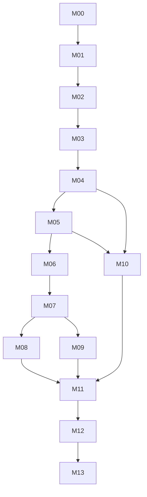

# Development Plan — Escape Protocol: The Last Exit

Version 2.3 (Module 05 Update) — **DRAFT, awaiting student review**.

The deadline extension is granted but the **new date is not known** (Q-01). This plan therefore uses *relative effort* (percent of total effort and ordered checkpoints), not calendar dates. Once the date is confirmed, convert the percentages into dates and record them in `docs/Development-Log.md`.

---

## 1. Roadmap Overview

| Module | Title | Effort share | Class | Playable? |
|---|---|---:|---|---|
| M00 | Requirements, Proposal, SRS | 5 % | Core | — |
| M01 | Architecture, database design, UML | 7 % | Core | — |
| M02 | Maven project foundation | 3 % | Core | Window opens |
| M03 | Domain model and ADTs | 8 % | Core | — |
| M04 | Game engine and progression | 8 % | Core | Headless |
| M05 | Puzzle system | 9 % | Core | Headless |
| M06 | Swing user interface | 12 % | Core | **Playable core** |
| M07 | Timer, scoring, concurrency | 7 % | Core | Playable + timed |
| M08 | Persistence and session handling | 5 % | Required after core | Save/continue |
| M09 | Socket leaderboard and networking | 10 % | Required deliverable | Networked |
| M10 | Recursion, parser generator, little language | 9 % | Required deliverable | Rules from ERL |
| M11 | Comprehensive testing, debugging, review | 7 % | Core | — |
| M12 | Documentation and final traceability | 5 % | Core | — |
| M13 | Packaging, deployment, presentation | 5 % | Core | JAR demo |
| | **Total** | **100 %** | | |

**Class meanings:** *Core* = needed for the playable game and the baseline documentation. *Required after core* and *Required deliverable* = built after the playable core, but they remain mandatory deliverables tied to official SCD concepts; they are scheduled later, not optional. M09 (socket leaderboard) and M10 (ANTLR parser generator and little language) cannot be deleted or reclassified as optional.

Contingency is taken *inside* these shares: if time runs short, cut P3 first, then reduce polish in M06, then the optional symbol puzzle and pause/resume. **M09 and M10 are never silently cut** — if blocked, the traceability row is marked `BLOCKED` with a smaller honest demonstration.

## 2. Module Dependencies

Consistency with the roadmap: every module M00–M13 appears once as a node; each arrow is a prerequisite (M01 architecture and database design precedes all implementation from M02 onward; M09 and M10 both feed M11).

Notes: M10 can start after M05 (engine exposes `UnlockRule`), so a member can work on it in parallel with M06–M09. M08 and M09 are independent of each other.

## 3. Module Details

Class names are defined by the architecture and design documents. Base package `com.escapeprotocol`.

### M00 — Requirements, Proposal, SRS

- **Deliverables:** `docs/Proposal.md`, `docs/SRS.md`, `docs/Requirements-Traceability.md`, `docs/Development-Plan.md`, `docs/Development-Log.md`.
- **Tests:** document review against the 23-point checklist.
- **Concepts:** C-07 (designing specifications — requirements first), AR-01, AR-02.
- **Checkpoint:** student review → peer review → commit `docs: add module 00 requirements, SRS and plan`.

### M01 — Architecture, Database Design, UML

- **Deliverables:** `docs/Architecture.md`, `docs/Design.md` with layered architecture, package map, class responsibilities, interfaces, ER diagram, use-case, class, activity, two sequence, state, component, concurrency diagrams, frozen protocol, ERL grammar draft, data-structure justification table.
- **Tests:** diagram syntax rendered (Mermaid preview); consistency check with SRS IDs.
- **Concepts:** C-06, C-07, C-14, AR-03, AR-06.
- **Checkpoint:** cross-member review → commit `docs: add architecture, data model and UML`.

### M02 — Maven Project Foundation

- **Deliverables:** `pom.xml` (release 21, JUnit 5, `-Xlint:all`, jar plugin with main class, ANTLR plugin smoke test), package skeleton, `Main` opening a basic Swing window, one trivial passing test, `.gitignore` check, README stub.
- **Tests:** `mvn clean test`, `mvn clean package`, run window. ANTLR+JDK 27 smoke test (risk R-02).
- **Concepts:** C-01, C-02, C-03, C-05.
- **Checkpoint:** commit `chore: initialize Maven project`.

### M03 — Domain Model and ADTs

- **Implemented main files:**
  - `player/Player.java`
  - `util/Validators.java`
  - `rooms/RoomId.java`
  - `rooms/Room.java`
  - `inventory/Item.java`
  - `inventory/ItemKind.java`
  - `inventory/Inventory.java`
  - `game/GameState.java`

- **Tests:**
  - `PlayerTest`
  - `ValidatorsTest`
  - `RoomOrderTest`
  - `RoomTest`
  - `InventoryTest`
  - `InventoryRepInvariantTest`
  - `ItemEqualityTest`
  - `ItemImmutabilityTest`
  - `GameStateTransitionTest`

- **Verification evidence:** `mvn clean test` completed successfully with 64 tests (the 59 Module 03 tests plus the 5 earlier Module 02 tests), 0 failures, 0 errors, and 0 skipped tests (student-reported; an earlier version of this line said 59). `mvn clean package` also completed successfully and generated `target/escape-protocol.jar`.
- **Concepts:** C-08, C-09, C-12, C-13, C-15.
- **Checkpoint:** after documentation review, Git status and diff checks, commit `feat: implement domain model and inventory ADT`.

### M04 — Game Engine and Progression

- **Status:** **Completed.** All four parts were implemented, verified locally (`mvn clean test` 199 tests passed; `mvn clean package` BUILD SUCCESS; student-reported) and committed and pushed as `c3740b9 feat: implement core game engine`.
- **Implemented main files:**
  - `game/GameEngine.java`
  - `game/GameSession.java`
  - `game/SessionSnapshot.java`
  - `game/GameCatalog.java`
  - `game/UnlockRule.java`, `game/UnlockContext.java`, `game/HardCodedUnlockRule.java`
  - `game/ScoreCalculator.java`, `game/HintService.java`
  - `game/GameListener.java`, `game/SubmissionResult.java`, `game/HintResult.java`
  - `puzzles/Puzzle.java`, `puzzles/PuzzleResult.java` (contract only, decision D1; the real puzzles are Module 05)
- **Specs first:** Javadoc contracts (preconditions, postconditions, exceptions, abstraction function, representation invariant and lock guard) were written together with the code for the public classes.
- **Implemented tests:**
  - `GameEngineTest`, `GameSessionTest`, `ProgressionTest`, `ScoreCalculatorTest`, `HintServiceTest`
  - `GameCatalogTest`, `UnlockContextTest`, `ResultTypesTest`, `PuzzleResultTest`
  - test-only helper `FakePuzzle` (not part of the game)
  - `GameStateTransitionTest` already exists from Module 03.
- **Verification evidence (student-reported):** after Part 1, 99 tests; after Part 2, 130 tests; after Part 3, 170 tests, with 0 failures, 0 errors and 0 skipped, and `mvn clean package` BUILD SUCCESS. Part 4 added 29 `GameEngineTest` tests; the final total is 199 tests with 0 failures, 0 errors and 0 skipped.
- **Concepts:** C-03, C-06, C-07, C-08, C-09, C-12, C-13, C-14, C-20 (statuses in `docs/Requirements-Traceability.md`; the timer and concurrency design of C-19 belong to M07).
- **Checkpoint:** committed and pushed as `c3740b9 feat: implement core game engine` (student-reported).

### M05 — Puzzle System

- **Status:** **Implemented; local verification pending.** The code and tests were delivered in one archive. No Maven result for Module 05 is recorded yet, and Module 05 is not committed.
- **Implemented main files:**
  - `puzzles/OfficePuzzle.java`, `puzzles/LibraryPuzzle.java`, `puzzles/SequencePuzzle.java`, `puzzles/FinalExitPuzzle.java`
  - `util/Validators.java`: extended with the puzzle input rules (year, Library order, sequence answer, Final Exit code); the player-name rule is unchanged
  - `game/GameCatalog.java`: one new factory, `standardWithPuzzles()`; nothing else changed
  - `puzzles/Puzzle` and `puzzles/PuzzleResult` exist since Module 04 (decision D1) and were reused unchanged.
- **Implemented tests:** `OfficePuzzleTest`, `LibraryPuzzleTest`, `SequencePuzzleTest`, `FinalExitPuzzleTest`, `PuzzleContractTest`, `ResubmitTest`, `PenaltyRulesTest`; `ValidatorsTest` and `GameCatalogTest` were extended (tests appended, none changed or removed). That is 104 new tests; the expected total is 303 (199 + 104), **not yet verified locally**.
- **SymbolPuzzle (FR-PZ-07, P2): deferred** (decision DEC-15). It is not implemented and not in `GameCatalog`, so `lab_sequence` alone completes the Laboratory. The SRS requirement text is unchanged and FR-PZ-07 stays open as a deferred P2 item.
- **Concepts:** C-14, C-17 (regex), C-08 (statuses in `docs/Requirements-Traceability.md`).
- **Checkpoint:** after local verification and `git status`/`git diff`, commit `feat: implement puzzle system`. Not committed yet.

### M06 — Swing User Interface

- **Planned files:** `ui/MainFrame`, `Theme`, `MainMenuPanel`, `NameEntryPanel`, `InstructionsPanel`, `GamePanel`, `RoomNavigator`, `InventoryPanel`, `FeedbackLabel`, `VictoryPanel`, `GameOverPanel`, `EdtUtil`, plus per-room puzzle views.
- **Tests:** manual checklists MT-UI-01…20 (click every control); engine untouched by UI tests.
- **Concepts:** C-24.
- **Checkpoint:** playable core demonstrated → commit `feat: implement Swing UI and room screens`. *(First time the game is playable end-to-end except real-time countdown, which M07 completes; if needed the timer module can be pulled forward.)*

### M07 — Timer, Scoring, Concurrency

- **Planned files:** `concurrency/GameTimer` (with injectable `Clock`), engine integration, pause/resume (P2), UI timer label.
- **Tests:** `GameTimerTest`, `PauseResumeTest`, `SessionRaceTest`, MT-TIM-01.
- **Concepts:** C-19, C-20, C-23 (session lock).
- **Checkpoint:** commit `feat: add countdown timer and thread-safe session`.

### M08 — Persistence and Session Handling

- **Planned files:** `storage/SaveRepository`, `FileSaveRepository`, `LeaderboardFile`, Continue Game wiring.
- **Tests:** `SaveLoadTest`, `CorruptSaveTest`, `TamperedSaveTest`, `LeaderboardPersistenceTest`.
- **Concepts:** C-14, C-08; database-design distinction documented in `docs/Limitations.md`.
- **Checkpoint:** commit `feat: add file-based save and load`.

### M09 — Socket Leaderboard and Networking

- **Planned files:** `networking/Protocol`, `Leaderboard`, `RequestQueue`, `ClientHandler`, `LeaderboardServer`, `LeaderboardClient`, `app/ServerMain`, `ui/LeaderboardPanel`, submit-score wiring.
- **Tests:** `ProtocolTest`, `LeaderboardTest`, `LeaderboardConcurrencyTest`, `RequestQueueTest`, `MalformedRequestTest`, `SocketIntegrationTest`, `MultiClientTest`, `ClientTimeoutTest`, `DisconnectTest`, `ServerShutdownTest`, MT-NET-01.
- **Concepts:** C-12, C-19–C-23.
- **Checkpoint:** commit `feat: add TCP leaderboard server and client`.
- **Build order inside M09:** (1) `Leaderboard` ADT + tests → (2) `Protocol` parsing + tests → (3) server with queue + handlers → (4) client → (5) UI wiring → (6) concurrency/stress tests.

### M10 — Recursion, Parser Generator, Little Language

- **Planned files:** `lang/Expr` (+ records), `lang/AstBuilder`, `lang/ExprEvaluator`, `lang/RuleLoader`, `src/main/antlr4/.../Escape.g4`, `src/main/resources/rules/game.erl`, `game/ErlUnlockRule`, `clues/ClueNode`, `game/GameStats`.
- **Tests:** `ExprStructureTest`, `ExprEvaluatorTest`, `RuleParserTest`, `RuleSyntaxErrorTest`, `UnlockRuleIntegrationTest`, `ClueTreeTest`, `GameStatsTest`.
- **Concepts:** C-10, C-16, C-17, C-18, C-25, C-26.
- **Checkpoint:** commit `feat: add Escape Rule Language and recursive clue tree`.
- **Fallback if ANTLR cannot run on the installed JDK:** try running the ANTLR tool JAR with a Java 21 runtime if available, or use another generator; record in the log. Do not substitute hand-written regex parsing and claim C-18.

### M11 — Comprehensive Testing, Debugging, Code Review

- **Deliverables:** full suite run, repeated concurrency runs, `docs/Testing.md` with real outputs, `docs/Code-Review-Log.md`, defect fixes + regression tests, static check log.
- **Concepts:** C-03, C-04, C-11, C-01.
- **Checkpoint:** commit `test: complete test suite and review fixes`.

### M12 — Documentation and Final Traceability

- **Deliverables:** `README.md`, `docs/SCD-Concept-Mapping.md`, `docs/Limitations.md`, user and developer guide, final UML review, filled contribution matrix, Requirements-Traceability statuses updated *only* from evidence.
- **Checkpoint:** commit `docs: finalize documentation and traceability`.

### M13 — Packaging, Deployment, Presentation

- **Deliverables:** runnable JAR, launch instructions for game and server, clean-machine run (if possible), demo script, viva Q&A, per-member checklist (`docs/Demo-and-Viva.md`), final GitHub review.
- **Tests:** MT-DEP-01, final `mvn clean package`, rehearsal.
- **Checkpoint:** commit `chore: package release and add demo guide`; tag a release (optional).

## 4. Review and Git Checkpoints

For every module:

1. Author finishes work; `mvn clean test` passes (from M02 onward).
2. A **different member** reviews using the checklist (below); issues logged in `docs/Code-Review-Log.md`.
3. `git status` and `git diff` checked; no build output, IDE files or secrets staged.
4. Commit with a descriptive message; push to GitHub; confirm with `git log -1 --oneline` and `git status`.
5. Update `docs/Development-Log.md` and the status column in `docs/Requirements-Traceability.md` (evidence only).

**Review checklist (summary):** matches SRS IDs; Javadoc contract present; inputs validated; no Swing outside `ui`; EDT rules; shared state has a documented guard; resources closed; tests cover normal/invalid/boundary; no dead buttons; names clear; no duplicated code.

Branching: `main` is always buildable. Use short-lived `feature/<module>` branches when two members work in parallel (e.g., M09 and M10), merged after review.

## 5. Team Responsibilities — **TO BE ASSIGNED**

| Area | Lead | Reviewer |
|---|---|---|
| Requirements, documentation, UML (M00, M01, M12) | `[TBA]` | `[TBA]` |
| Domain, engine (M03, M04) | `[TBA]` | `[TBA]` |
| Puzzles (M05) | `[TBA]` | `[TBA]` |
| Swing UI (M06) | `[TBA]` | `[TBA]` |
| Timer and concurrency (M07) | `[TBA]` | `[TBA]` |
| Persistence (M08) | `[TBA]` | `[TBA]` |
| Socket server/client (M09) | `[TBA]` | `[TBA]` |
| Parser/little language, recursion (M10) | `[TBA]` | `[TBA]` |
| Testing, debugging, review (M11) | `[TBA]` | `[TBA]` |
| Git/GitHub, integration, deployment, presentation (M02, M13) | `[TBA]` | `[TBA]` |

With 2 members, combine rows; with 3, aim for each member to lead at least one of {engine/puzzles, UI, networking/language} so every member has demonstrable work. **No member may claim work they did not do.**

## 6. Risks and Contingency Plans

| ID | Risk | Contingency |
|---|---|---|
| R-01 | Time shortage | Cut P3, then symbol puzzle, pause/resume, UI polish; never cut M09/M10 silently |
| R-02 | ANTLR/JDK 27 problem | Smoke test in M02; fallbacks in M10; if blocked mark C-18 `BLOCKED` and consult instructor |
| R-03 | Concurrency bugs | Keep shared state small; one lock per object; stress tests; peer review of every lock |
| R-04 | Unequal contribution | Contribution matrix updated each module; per-member commits |
| R-05 | DBMS required | Repository interfaces + JDBC implementation + schema from ER model |
| R-06 | Deadline date unknown | Ask Q-01; interim plan uses percentages |
| R-07 | Idea approval unclear | Ask Q-05 now |
| R-08 | Copy/paste errors | Complete files, exact paths, compile after each file group |
| R-09 | Swing threading bugs | `EdtUtil`, review item |
| R-10 | Port/firewall issues | Configurable port, localhost default |
| R-11 | Merge conflicts | Small modules, feature branches, frequent pull |

## 7. Time Allocation (relative)

See §1. Suggested pacing once the date is known: finish M00–M02 in the first ~15 %; reach the **playable core (M06) by ~55 %**; finish M07–M10 by ~85 %; reserve the last ~15 % for M11–M13 plus rehearsal. Integration and review time is included in each module's share.

## 8. Group Contribution Matrix (fill in during development)

| Member | Module / task | Files / classes | Commits (hashes) | Tests written | Reviewed by | Evidence |
|---|---|---|---|---|---|---|
| `[Name and Roll Number]` | | | | | | |
| `[Name and Roll Number]` | | | | | | |
| `[Name and Roll Number — if applicable]` | | | | | | |

## 9. Viva Readiness Checklist (per member)

- [ ] Can draw and explain the architecture and package responsibilities.
- [ ] Can explain own classes line by line and why designed this way.
- [ ] Can run and explain own tests.
- [ ] Can explain at least the concepts C-xx assigned as "owned" **and** summarise all 26.
- [ ] Can explain the concurrency design (timer, session lock, queue, leaderboard lock).
- [ ] Can show own commits on GitHub.