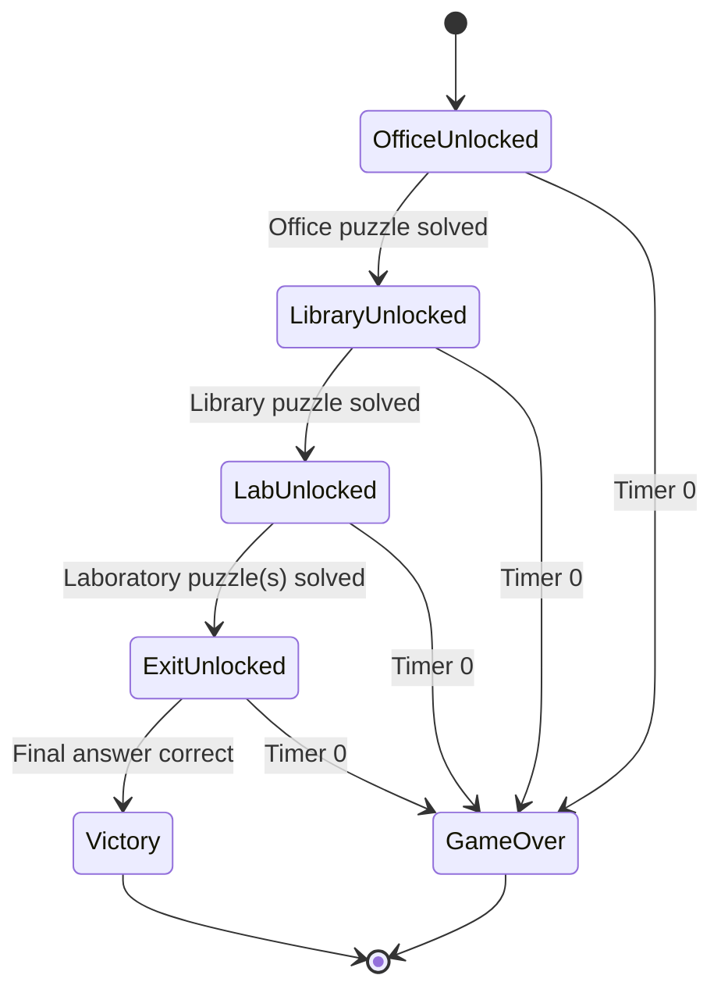
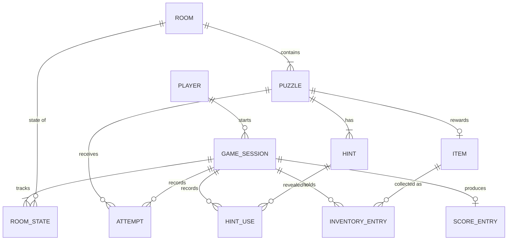

# Software Requirements Specification — Escape Protocol: The Last Exit

| Item | Value |
|---|---|
| Version | 2.0 (Module 00 Final Revision) — **DRAFT, awaiting student review** |
| Course | SCD, SE V, Sukkur IBA University — Dr. Jawad Hussain Awan |
| Team | Member 1 `[Name and Roll Number]`, Member 2 `[Name and Roll Number]`, Member 3 `[Name and Roll Number — if applicable]` |

Values marked **(proposed)** are initial design choices that will be confirmed or adjusted in the stated module. Priority: **P1** must work, **P2** planned after the core works, **P3** stretch. Requirement IDs are used by `docs/Requirements-Traceability.md`.

---

## 1. Purpose

This SRS specifies the behaviour, constraints and acceptance criteria of Escape Protocol — The Last Exit, a Java Swing escape-room game with a TCP leaderboard, so that it can be designed, implemented, tested and demonstrated for the SCD assignment.

## 2. Scope

The product consists of two Java programs in one Maven project:

1. **Game client** (Swing): menu, four-room game, timer, scoring, persistence, leaderboard client.
2. **Leaderboard server** (console): multi-client TCP server holding a thread-safe ranking.

Not included: a DBMS, accounts/authentication, internet hosting, multiplayer gameplay.

## 3. Definitions and Terminology

| Term | Meaning |
|---|---|
| Session | One play-through from New Game to Victory/Game Over |
| Item | A key, code or clue stored in the inventory |
| Attempt | A syntactically valid answer submitted to a puzzle |
| Invalid input | Input that fails format validation (not counted as an attempt) |
| Terminal state | VICTORY or GAME_OVER |
| ERL | Escape Rule Language — the little language for unlock rules |
| AST | Abstract syntax tree |
| AF / RI | Abstraction function / representation invariant |
| EDT | Swing Event Dispatch Thread |
| Leaderboard | Server-side ranking of submitted scores |

## 4. Stakeholders

| Stakeholder | Interest |
|---|---|
| Player | Playable, fair, clear game |
| Group members | Buildable, explainable, fairly shared work |
| Instructor | Coverage of all assignment requirements and concepts |
| Viva examiners | Evidence of individual understanding |

## 5. User Roles

| Role | Description |
|---|---|
| Player | Uses the Swing game |
| Leaderboard operator | Starts/stops the server (typically a group member) |
| Developer | Builds, tests, packages the project |

## 6. Assumptions and Constraints

- A-01: Windows 10, Java runtime 21 or newer; project compiled with `--release 21`.
- A-02: Server and clients run on the same machine or LAN; default host `localhost`.
- A-03: Revised deadline is **unknown** (extension granted); plans are in relative effort.
- A-04: No DBMS (pending instructor confirmation Q-02).
- C-01: Swing only (no JavaFX); minimal external dependencies (ANTLR planned, JUnit 5).
- C-02: Source code must be original and documented; each member can explain it.
- C-03: Domain logic must not depend on Swing.

## 7. Functional Requirements

### 7.1 Main menu and player (FR-MN)

| ID | Requirement | Pri | Module |
|---|---|---|---|
| FR-MN-01 | The main menu shall show the title, a subtitle and buttons: New Game, Continue Game, Leaderboard, Instructions, Exit. | P1 | M06 |
| FR-MN-02 | Before a game starts the player shall enter a name; after trimming it must match `^[A-Za-z0-9 _-]{1,20}$`. Otherwise an error is shown and no game starts. | P1 | M06 |
| FR-MN-03 | Instructions shall display rules, timer, scoring and hint costs; a Back button shall return to the menu. | P1 | M06 |
| FR-MN-04 | Exit shall stop the timer and background threads and close the application. | P1 | M06/M07 |
| FR-MN-05 | Continue Game shall be enabled only if a valid save exists (otherwise disabled); it shall load that save. | P2 | M08 |
| FR-MN-06 | The Leaderboard button shall open the leaderboard screen (FR-LB-11). | P2 | M09 |

### 7.2 Game lifecycle and progression (FR-GM)

| ID | Requirement | Pri | Module |
|---|---|---|---|
| FR-GM-01 | New Game shall create a session with the player name, a 1200-second timer, base score 1000 **(proposed)**, empty inventory, only Office unlocked. | P1 | M04 |
| FR-GM-02 | Rooms shall exist in the order Office, Library, Laboratory, Final Exit. | P1 | M03 |
| FR-GM-03 | A room shall unlock only when its unlock rule is satisfied (Library after Office puzzle, Laboratory after Library puzzle, Final Exit after Laboratory puzzle(s)). Entering a locked room shall be refused with a message. | P1 | M04 |
| FR-GM-04 | The session shall follow states NOT_STARTED → RUNNING → (PAUSED ↔ RUNNING) → VICTORY or GAME_OVER. Illegal transitions shall be rejected and leave state unchanged. | P1 | M04 |
| FR-GM-05 | A correct Final Exit answer in RUNNING state shall move to VICTORY, stop the timer and compute the final score. | P1 | M04 |
| FR-GM-06 | Timer reaching 00:00 in RUNNING state shall move to GAME_OVER; later submissions shall be ignored. | P1 | M07 |
| FR-GM-07 | Restart shall create a fresh session (new state, timer reset, inventory cleared). If a game is running the player shall confirm first. | P1 | M04/M06 |
| FR-GM-08 | Pause shall stop the countdown and disable puzzle input; Resume shall continue from the same remaining time. | P2 | M07 |

### 7.3 Puzzles (FR-PZ)

| ID | Requirement | Pri | Module |
|---|---|---|---|
| FR-PZ-01 | Every puzzle shall implement a `Puzzle` interface providing id, prompt, answer submission returning CORRECT / INCORRECT / INVALID_FORMAT, and progressive hints. | P1 | M05 |
| FR-PZ-02 | Office: documents dated 1998, 2004 and 2012 shall be shown. Answer `2004` is correct; other 4-digit numbers are incorrect; non-4-digit input is invalid format. | P1 | M05 |
| FR-PZ-03 | Office success shall unlock the computer/drawer and add the item "Office Key" and its clue to the inventory. | P1 | M05 |
| FR-PZ-04 | Library: the player shall order Red (1985), Green (1992), Blue (2001), Yellow (2010). Correct order is Red, Green, Blue, Yellow. A selection with missing or duplicate books is invalid format. | P1 | M05 |
| FR-PZ-05 | Library success shall add the code `7394` to the inventory. | P1 | M05 |
| FR-PZ-06 | Laboratory sequence `2, 6, 12, 20, ?`: integer `30` is correct; other integers incorrect; non-integer invalid. | P1 | M05 |
| FR-PZ-07 | Laboratory symbol-matching puzzle (match three symbols to their meanings; all pairs must be right). If implemented it is required for Laboratory completion; if cut, the sequence puzzle alone completes the room. Decision recorded in M05. | P2 | M05 |
| FR-PZ-08 | Laboratory completion shall add a final clue item containing the value `30`. | P1 | M05 |
| FR-PZ-09 | Final Exit shall accept one text answer of the form `YYYY-CCCC-N` (regex `^\d{4}-\d{4}-\d{1,3}$`) **(proposed)**; it is correct only if the three parts equal the Office year, Library code and Laboratory answer (`2004-7394-30`). It shall require all three clues in the inventory; otherwise it shall say which kind of clue is missing. | P1 | M05 |
| FR-PZ-10 | A wrong Final Exit answer shall report how many of the three parts are correct (not which), and apply the wrong-attempt penalty. | P1 | M05 |
| FR-PZ-11 | Submissions shall be refused unless the game is RUNNING and the puzzle's room is unlocked. | P1 | M04 |
| FR-PZ-12 | A solved puzzle stays solved; resubmitting shall not add duplicate items or penalties. | P1 | M05 |
| FR-PZ-13 | Invalid-format input shall give format feedback and **no** penalty; incorrect valid input counts as an attempt. | P1 | M05 |

### 7.4 Inventory, clues and hints (FR-IV)

| ID | Requirement | Pri | Module |
|---|---|---|---|
| FR-IV-01 | The inventory shall hold items without duplicates (items equal by id). | P1 | M03 |
| FR-IV-02 | Items shall be added only as a result of solving a puzzle. | P1 | M04 |
| FR-IV-03 | The UI shall list collected items with name and description and update immediately on change. | P1 | M06 |
| FR-IV-04 | Each puzzle shall have 3 progressive hints; requesting a new hint reveals the next one and costs 50 points **(proposed)**; already revealed hints can be viewed again at no cost. | P1 | M04/M05 |
| FR-IV-05 | When no hints remain, or the room is not active, the hint action shall show a message and cost nothing. | P1 | M04 |
| FR-IV-06 | Clue dependencies shall be modelled as a recursive tree (see FR-AD-01). | P2 | M10 |

### 7.5 Timer and scoring (FR-TS)

| ID | Requirement | Pri | Module |
|---|---|---|---|
| FR-TS-01 | A countdown from 20:00 shall be shown as mm:ss and update every second while RUNNING. | P1 | M07 |
| FR-TS-02 | Ticking shall run on a background scheduler; UI updates shall be posted to the EDT. | P1 | M07 |
| FR-TS-03 | With an injectable clock, remaining time shall be exact in tests; in manual runs it shall stay within ±2 s of wall-clock time after 5 minutes. | P1 | M07 |
| FR-TS-04 | Each wrong attempt costs 25 points and each hint 50 points **(proposed)**; the score never drops below 0. | P1 | M04 |
| FR-TS-05 | Final score on victory = current score + 2 × remaining seconds **(proposed)**. | P1 | M04 |
| FR-TS-06 | The timer shall stop on victory, game over, exit, and pause. | P1 | M07 |
| FR-TS-07 | The current score shall be visible during play. | P1 | M06 |
| FR-TS-08 | If timer expiry and a correct final answer happen concurrently, exactly one terminal state results and the session is never both won and lost. | P1 | M07 |

### 7.6 Graphical user interface (FR-UI)

| ID | Requirement | Pri | Module |
|---|---|---|---|
| FR-UI-01 | The UI shall use a dark cyber-industrial theme (charcoal/black surfaces, purple/red/muted-green accents, body text ≥ 14 pt). | P1 | M06 |
| FR-UI-02 | Screens: menu, name entry, instructions, room/gameplay, victory, game over, leaderboard. | P1 | M06 |
| FR-UI-03 | The gameplay screen shall show timer, score, room name, puzzle area, inventory panel, hint button and a feedback area. | P1 | M06 |
| FR-UI-04 | The player can move between unlocked rooms; locked rooms are visibly locked. | P1 | M06 |
| FR-UI-05 | Every visible control shall perform its advertised action; no placeholder buttons. | P1 | M06 |
| FR-UI-06 | Success, wrong-answer and invalid-input feedback shall be clearly distinguishable. | P1 | M06 |
| FR-UI-07 | All Swing component updates shall occur on the EDT. | P1 | M06/M07 |
| FR-UI-08 | Victory shows name, final score, time left, hints used, wrong attempts, and a "Submit score" action (P2) and Restart/Menu; Game Over shows the reason and Restart/Menu. | P1 | M06 |
| FR-UI-09 | The main window shall have a minimum size of 900×600 and remain usable when resized. | P1 | M06 |

### 7.7 Persistence (FR-PS)

| ID | Requirement | Pri | Module |
|---|---|---|---|
| FR-PS-01 | Save files shall be stored under the user's home directory in an `.escape-protocol` folder **(proposed)**. | P2 | M08 |
| FR-PS-02 | The game shall save on room completion and on "Save & Exit". | P2 | M08 |
| FR-PS-03 | Loading shall validate the file; a corrupt/invalid file shall produce an error message, never a crash, and shall not alter state. | P2 | M08 |
| FR-PS-04 | Loading shall restore remaining time, score, inventory, solved puzzles and unlocked rooms. | P2 | M08 |
| FR-PS-05 | The server shall persist the leaderboard to a file with write-to-temp-then-rename and reload it at start-up. | P2 | M08/M09 |
| FR-PS-06 | Loaded state shall be checked against domain invariants so a tampered save cannot unlock rooms without the required items/solutions. | P2 | M08 |

### 7.8 Socket leaderboard (FR-LB)

| ID | Requirement | Pri | Module |
|---|---|---|---|
| FR-LB-01 | A standalone server shall listen on a TCP port (default 5050, configurable) **(proposed)**. | P2 | M09 |
| FR-LB-02 | The server shall serve multiple clients simultaneously (tests with ≥ 20). | P2 | M09 |
| FR-LB-03 | Protocol: UTF-8, one request per line. Requests: `SUBMIT <name> <score>`, `TOP <n>`, `PING`, `QUIT`. Replies: `OK ...`, `PONG`, `TOP <count>` followed by lines `<rank> <name> <score>`, or `ERR <CODE> <message>`. **(proposed; frozen in M01)** | P2 | M09 |
| FR-LB-04 | The server shall validate: name by the player-name regex; score integer 0–5000. Invalid → `ERR` reply, no state change. | P2 | M09 |
| FR-LB-05 | Unknown commands, malformed lines or lines over 256 characters shall yield `ERR`; the server shall keep running and other clients unaffected. | P2 | M09 |
| FR-LB-06 | The leaderboard shall be thread-safe: no lost entries under concurrent submissions; ordering by score descending then earlier submission first; `TOP n` accepts 1–50. | P2 | M09 |
| FR-LB-07 | Client-handler threads shall enqueue requests on a `BlockingQueue`; a worker thread shall consume and apply them (producer–consumer). | P2 | M09 |
| FR-LB-08 | The client shall use a 3-second connect timeout and shall never block the EDT; if the server is unreachable a message is shown and the game continues. | P2 | M09 |
| FR-LB-09 | A client disconnecting (cleanly or abruptly) shall not affect others and the server shall release its resources. | P2 | M09 |
| FR-LB-10 | Server shutdown shall stop accepting, finish queued work, close sockets, and terminate threads; clients shall handle end-of-stream cleanly. | P2 | M09 |
| FR-LB-11 | The leaderboard screen shall fetch the top 10 and show rank, name, score; if unreachable show an error message. | P2 | M09 |
| FR-LB-12 | A session's score can be submitted at most once from the UI; a failed submission can be retried. | P2 | M09 |
| FR-LB-13 | The server shall log connections, disconnections and rejected requests to the console. | P2 | M09 |

### 7.9 Little language, recursion and functional operations (FR-LL, FR-AD)

| ID | Requirement | Pri | Module |
|---|---|---|---|
| FR-LL-01 | The Escape Rule Language (ERL) shall express unlock rules, e.g. `unlock library when has("office_key");` and `unlock exit when has("code_7394") and solved("lab_sequence") and not has("x");`. Operators: `and`, `or`, `not`, parentheses; predicates `has(id)` and `solved(id)`. | P2 | M10 |
| FR-LL-02 | The ERL grammar shall be written for a real parser generator (ANTLR 4) and the parser generated by the build. | P2 | M10 |
| FR-LL-03 | Parsing shall produce an immutable recursive AST (`Expr` with Has, Solved, And, Or, Not). | P2 | M10 |
| FR-LL-04 | A recursive evaluator shall evaluate an AST against the inventory and solved-puzzle set; recursive helpers shall also compute AST depth and the set of referenced ids. | P2 | M10 |
| FR-LL-05 | Syntax errors shall be reported with line and column; an invalid rules file shall stop the game from starting with a clear message. | P2 | M10 |
| FR-LL-06 | Room unlocking in the running game shall be decided by evaluating ERL rules (the engine uses an `UnlockRule` interface from M04 so ERL can be plugged in). | P2 | M10 |
| FR-LL-07 | All format checks (player name, year, 4-digit code, final answer, protocol lines) shall use centrally defined regular expressions. | P1 | M05 |
| FR-AD-01 | Clue dependencies shall be a recursive `ClueNode` tree with recursive operations `allRequired()`, `depth()` and `isObtainable(ownedIds)`. | P2 | M10 |
| FR-AD-02 | The game shall use stream map/filter/reduce on real data, at minimum: filter solved puzzles; map inventory to display names; reduce hint/attempt penalties to a total; leaderboard statistics (count, average, maximum). | P2 | M10 |

## 8. Room Progression

## 9. Use Cases

| ID | Use case | Actor | Main flow (summary) | Related FR |
|---|---|---|---|---|
| UC-01 | Start new game | Player | Enter name → validate → session created → Office shown | FR-MN-02, FR-GM-01 |
| UC-02 | Solve a puzzle | Player | Open room → read clues → submit answer → feedback → reward/penalty | FR-PZ-* |
| UC-03 | Use a hint | Player | Press Hint → next hint shown → score reduced | FR-IV-04 |
| UC-04 | Move between rooms | Player | Select room → if unlocked show, else refuse | FR-GM-03 |
| UC-05 | Escape (win) | Player | Enter final answer → VICTORY → score | FR-PZ-09, FR-GM-05 |
| UC-06 | Lose by timeout | Player | Timer hits 0 → GAME_OVER | FR-GM-06 |
| UC-07 | Pause/resume, save, continue | Player | Pause / Save & Exit / Continue | FR-GM-08, FR-PS-* |
| UC-08 | Submit score | Player | Victory → Submit → server stores → confirmation | FR-LB-* |
| UC-09 | View leaderboard | Player | Open screen → fetch TOP 10 → display | FR-LB-11 |
| UC-10 | Run leaderboard server | Operator | Start server → accepts clients → stop gracefully | FR-LB-01, FR-LB-10 |

**Alternate flows:** invalid name (UC-01), invalid format answer (UC-02), locked room (UC-04), server unreachable (UC-08/09), corrupt save (UC-07).

## 10. Concurrency and Thread-Safety Requirements (CON)

| ID | Requirement |
|---|---|
| CON-01 | Each shared mutable object shall have a documented guarding mechanism (lock, atomic, or confinement) in its Javadoc. |
| CON-02 | `GameSession` state changes shall be atomic with respect to timer ticks, UI actions and expiry (single lock). |
| CON-03 | The server `Leaderboard` shall be guarded by a lock (read/write lock planned); queue hand-off uses `BlockingQueue`. |
| CON-04 | No Swing component shall be touched off the EDT; no network or file I/O on the EDT. |
| CON-05 | Locks shall be acquired in one documented order; no blocking I/O while holding a lock. |
| CON-06 | Background threads shall be named, stoppable, and stopped on exit (no leaked non-daemon threads). |
| CON-07 | Concurrency tests shall cover: simultaneous submissions from ≥ 20 clients, timer-vs-answer race, repeated start/stop of server. |

## 11. Error Handling and Security / Input Validation

| ID | Requirement |
|---|---|
| ERR-01 | Invalid input from any source (UI, socket, save file, ERL file) shall produce a clear message, never an uncaught exception or corrupted state. |
| ERR-02 | Unexpected exceptions shall be caught at UI action and thread boundaries, logged to console, and shown as a friendly dialog. |
| ERR-03 | Resources (sockets, streams, executors) shall be closed in `finally`/try-with-resources. |
| SEC-01 | All external input shall be validated (regex/range/length) before use. |
| SEC-02 | The server shall never execute or interpret received text beyond the fixed protocol; line length bounded (256); client count bounded **(proposed 100)**. |
| SEC-03 | No credentials, secrets or `.env` files in the repository. |
| SEC-04 | Save/leaderboard files are treated as untrusted on load (FR-PS-03, FR-PS-06). |

## 12. Logical Data Model (database design — first cut, finalised in Module 01)

No DBMS is planned. This section is the *logical design*; persistence is file-based. **Pending instructor confirmation (Q-02).**

| Entity | Key attributes | PK | FK | Constraints |
|---|---|---|---|---|
| PLAYER | name | name | — | matches name regex |
| GAME_SESSION | sessionId, playerName, state, remainingSeconds, score, startedAt | sessionId | playerName → PLAYER | state ∈ allowed set; 0 ≤ remainingSeconds ≤ 1200; score ≥ 0 |
| ROOM | roomId, name, orderIndex | roomId | — | orderIndex unique, 1–4 |
| ROOM_STATE | sessionId, roomId, unlocked | (sessionId, roomId) | sessionId, roomId | Office unlocked at start |
| PUZZLE | puzzleId, roomId, type, prompt | puzzleId | roomId → ROOM | ≥ 1 per room |
| ATTEMPT | sessionId, puzzleId, seq, answer, result | (sessionId, puzzleId, seq) | sessionId, puzzleId | result ∈ {CORRECT, INCORRECT} |
| HINT | puzzleId, level, text | (puzzleId, level) | puzzleId | level 1–3 |
| HINT_USE | sessionId, puzzleId, level | (sessionId, puzzleId, level) | → HINT | each level once per session |
| ITEM | itemId, name, description, kind | itemId | rewardedBy puzzleId | kind ∈ {KEY, CODE, CLUE} |
| INVENTORY_ENTRY | sessionId, itemId | (sessionId, itemId) | → GAME_SESSION, ITEM | no duplicates |
| SCORE_ENTRY | name, score, submittedAt | (name, submittedAt) | — | score 0–5000 |

**Persistence plan:** static definitions (ROOM, PUZZLE, HINT, ITEM) are in code/resources. Dynamic data (session, room state, inventory, hints used, attempts count) is written to a save file (**properties/text format fixed in M08**). SCORE_ENTRY is written by the server to a CSV-style file. **If a DBMS is required:** add repository interfaces (`SaveRepository`, `LeaderboardRepository`), implement them with JDBC, and generate the schema from the table above.

## 13. Non-Functional Requirements

| ID | Category | Requirement |
|---|---|---|
| NFR-PF-01 | Performance | The EDT shall never be blocked > 100 ms by game logic, I/O or network. |
| NFR-PF-02 | Performance | The game window appears within 5 s of launch on a typical lab PC. |
| NFR-PF-03 | Performance | The server answers each request < 1 s on localhost with 50 concurrent clients. |
| NFR-RL-01 | Reliability | Malformed client traffic shall not crash the server. |
| NFR-RL-02 | Reliability | A corrupt save file shall not crash the game. |
| NFR-US-01 | Usability | Body text ≥ 14 pt; text/background contrast high enough to read comfortably. |
| NFR-US-02 | Usability | A first-time player can finish the game using hints within the 20-minute limit. |
| NFR-MT-01 | Maintainability | Packages separated by responsibility; no Swing imports outside `ui`. |
| NFR-MT-02 | Maintainability | Public types/methods have Javadoc; ADTs document AF and RI; important methods state preconditions/postconditions. |
| NFR-MT-03 | Static checking | Build compiles with `-Xlint:all`; target zero warnings. |
| NFR-TS-01 | Testability | `mvn clean test` runs all tests from a clean checkout. |
| NFR-TS-02 | Testability | Target ≥ 70 % line coverage on `game`, `puzzles`, `inventory`, `lang`, `networking` (if a coverage tool is added; measured, not assumed). |
| NFR-PT-01 | Portability | Runs on Windows 10 with Java 21+. |
| NFR-DP-01 | Deployment | `mvn clean package` produces a runnable JAR; launch commands for game and server documented. |
| NFR-VC-01 | Version control | At least one reviewed commit per module; commits attributable to each member. |
| NFR-DC-01 | Documentation | README, SRS, architecture/design, testing, limitations, concept mapping, development log all present. |

## 14. Testing Acceptance Criteria

| ID | Criterion |
|---|---|
| AC-01 | `mvn clean test` finishes with 0 failures and 0 errors (evidence: pasted output in `docs/Testing.md`). |
| AC-02 | Every FR marked P1 has at least one passing automated test or a documented manual test with result. |
| AC-03 | Each puzzle has tests for correct, incorrect, invalid-format and boundary input. |
| AC-04 | Progression tests prove locked rooms cannot be entered or solved out of order. |
| AC-05 | Score tests prove penalties, floor at 0 and final-score formula. |
| AC-06 | Timer tests with an injectable clock cover tick, expiry, pause/resume, stop. |
| AC-07 | Concurrency tests (≥ 20 clients; timer/answer race) pass repeatedly (e.g., 20 consecutive runs). |
| AC-08 | Socket tests cover valid, invalid, oversize, abrupt disconnect, and server shutdown. |
| AC-09 | Parser tests cover valid rules, syntax errors with line/column, and evaluator results. |
| AC-10 | A full manual playthrough from menu to victory and one to game over is recorded with the actual result. |
| AC-11 | Every defect found is logged with a regression test. |

Passing means the actual observed result equals the expected result. No result is recorded unless the test was run.

## 15. Deployment Requirements

| ID | Requirement |
|---|---|
| DEP-01 | The game runs from an executable JAR with `java -jar`. |
| DEP-02 | The server runs from the same JAR (second main class) or a second JAR; command documented. |
| DEP-03 | README lists required Java version, build, run, and test commands for Windows CMD. |
| DEP-04 | Deployment is verified by running the built JAR (ideally on a second machine); until then it is *not* claimed. |

## 16. Open Items

See `docs/Development-Log.md` §7 for instructor-confirmation questions (Q-01 … Q-07).
